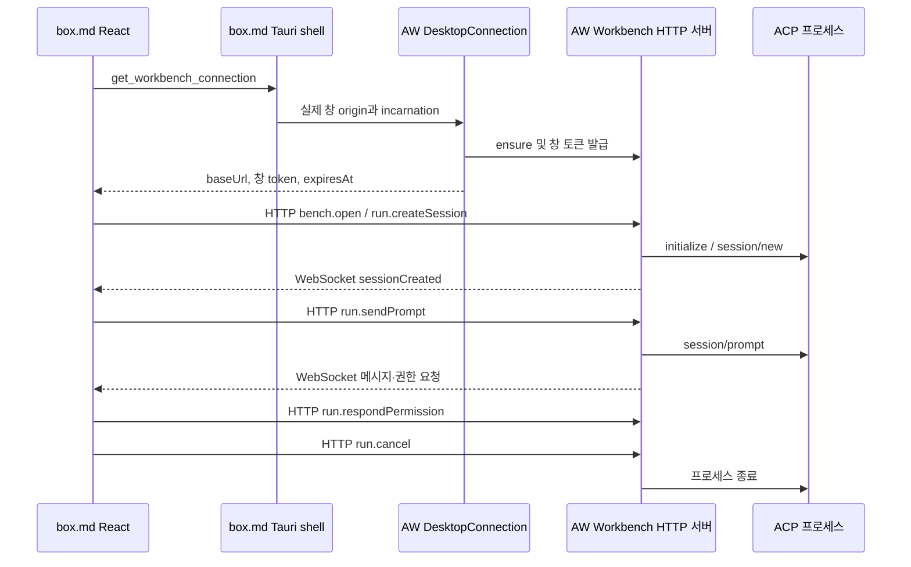

# AW 공유 라이브러리를 사용하는 ACP 채팅

box.md는 AW의 독립 Workbench 서버와 공유 채팅 클라이언트를 사용한다. 문서 작업 디렉터리를 선택하고 **에이전트 채팅 → 새 세션**을 누르면 첫 메시지를 보내지 않은 ACP 세션을 준비한다. 이후 같은 세션에서 메시지를 주고받고 권한 요청에 응답할 수 있다. **세션 종료**는 에이전트 프로세스를 종료한다. **채팅 숨기기**는 대화와 입력 중인 초안을 유지하며 진행 중인 응답을 중단하지 않는다.

## 연결 구조



- `entities/agent-chat`은 AW `createAgentChatClient`에 네이티브 연결 공급자를 연결한다.
- `features/agent-chat`은 작업 디렉터리별 클라이언트와 대화 상태를 유지한다. 다른 디렉터리로 전환한 뒤에도 해당 디렉터리의 세션으로 명령을 보낸다.
- Tauri는 공유 `workbench-desktop-client`로 서버 준비·창 토큰·임대를 관리한다. ACP 명령이나 이벤트를 Tauri IPC로 중계하지 않는다.
- owner token은 Rust 연결 모듈에만 존재한다. 브라우저에는 창 토큰만 전달하며 토큰을 localStorage나 문서에 저장하지 않는다. 허용 origin은 네이티브 창 URL에서 확인한다.
- 앱 종료는 창을 폐기하고 자신의 임대를 반환한다. 다른 클라이언트의 진행 중인 에이전트를 종료하지 않는다. UI unmount는 공유 클라이언트의 구독과 연결을 해제한다.
- 기본 서버 데이터는 AW와 같은 `com.yoophi.agentic-workbench` 앱 데이터 디렉터리를 사용한다. 테스트는 `BOX_WORKBENCH_DATA_DIR`로 분리한다.

현재 화면은 채팅 기능을 확인하기 위한 별도 패널이다. 최우측 컬럼 배치, 접기·펴기 및 너비 조절은 gh-17에서 AW `CollapsibleResizablePanels`를 재사용해 구현한다.

## 공유 버전과 빌드

AW submodule은 upstream `main`의 `760415c497f41081cba73a011981f2159c118de0`을 기반으로 ACP 프로세스 그룹 정리를 추가한 `c3aafbed7a173fd14113c1cb19f645ae97024a66`에 고정했다. 공유 Rust 모듈, idle 세션 API, TypeScript 채팅 클라이언트 및 Box 개발 origin 지원은 AW에 포함되어 있고, 프로세스 정리 보완은 원격 `fix/acp-process-group-cleanup` 브랜치에 push되어 있다. pnpm workspace에는 AW의 `workbench-client`와 `workbench-agent-client`만 포함한다.

```sh
git submodule update --init --recursive
pnpm install --frozen-lockfile
pnpm tauri:dev
pnpm tauri:build
```

Tauri 실행·빌드 전에 `scripts/prepare-workbench-server.mjs`가 같은 AW 버전의 독립 서버를 빌드하고 target triple을 붙여 sidecar를 준비한다. 개발은 debug, 배포는 release 프로파일을 사용한다. 빌드 산출물은 Git에 포함하지 않는다. `AW_WORKBENCH_SERVER_PATH`는 명시적인 개발 서버 실행 파일 재정의에 사용할 수 있다.

## gh-24 검증

- `pnpm check-types`, `pnpm build`, `pnpm test` 통과: 편집기 15, desktop 20, AW 기본 클라이언트 75, 채팅 facade 16개 테스트.
- `cargo fmt --all -- --check`, `cargo check --workspace --all-targets`, `cargo test -p box-desktop --lib` 통과: Box Rust 테스트 15개.
- `pnpm --filter @box/desktop test:integration`은 실제 Workbench HTTP/WS 서버와 가짜 ACP 프로세스로 HomePage를 검증한다. idle 초기화에 prompt가 없는지, 두 턴 메시지와 권한 승인, 프로세스 종료, 숨김 후 대화·초안 및 미저장 문서 유지, prompt 중복 없음까지 확인한다. 네이티브 문서·창 토큰 경계만 테스트 어댑터로 대체한다.
- macOS debug `.app` 번들 및 서버 sidecar 생성에 성공했다. 화면 제어 도구가 QA 창을 찾지 못해 실제 화면 확인은 gh-25에 남겨두었다. 설치된 에이전트 handshake와 여러 클라이언트의 앱 종료 검증도 gh-25 범위다.

프로덕션 번들은 기존 500 kB 경고 기준을 초과한다. 기능 검증 실패는 아니며 코드 분할은 추후 최적화 대상이다.

## gh-25 추가 검증 진행 상황

아래 검증은 고정된 AW 버전과 box.md 공유 클라이언트를 사용해 통과했다.

- 설치된 `codex-acp`, `claude-agent-acp`, `opencode acp` 각각에 대해 실제 HTTP/WS 경로로 idle 세션을 만들고 `sessionCreated` 이후 준비 상태와 종료 상태를 확인했다. 사용자 prompt는 보내지 않았으며 provider 대화 내용을 수집하지 않았다.
- AW `workbench-desktop-client` 테스트 23개: 동기 창 종료 hook, 창 토큰 폐기, 임대 반환, 다른 클라이언트의 자격 증명·작업대 유지.
- AW `owner_after_desktop` 테스트 2개: 데스크톱 창을 폐기한 후에도 실제 ACP의 진행 중인 턴이 계속되고, 다른 owner 클라이언트가 후속 출력과 취소를 처리하며 취소 후 에이전트 프로세스가 정리된다.
- AW `idle_session_http` 테스트 5개: idle 준비 및 중복 요청, 권한을 포함한 두 턴, 초기화 중 취소·프로세스 정리, 시작 실패, EOF 처리 및 기존 goal 실행 호환성.

설치 에이전트 검증은 개발자의 설치·인증 상태에 의존하므로 일반 CI에서는 실행하지 않는다. 명시적으로 실행하는 방법:

```sh
BOX_TEST_INSTALLED_ACP=1 pnpm --filter @box/desktop test:integration
cargo test --manifest-path vendor/agentic-workspace/Cargo.toml -p workbench-desktop-client
cargo test --manifest-path vendor/agentic-workspace/Cargo.toml -p workbench-host --features test-hooks --test owner_after_desktop
cargo test --manifest-path vendor/agentic-workspace/Cargo.toml -p workbench-core --features test-hooks --test idle_session_http
```

설치 에이전트 세션 3개와 HomePage 통합 1개를 함께 실행해 4개 테스트가 통과했다. 테스트 종료 후 해당 ACP 및 시험 HTTP host 프로세스가 남아 있지 않음을 확인했다.

## gh-25 실제 macOS 화면 검증

2026-10-14에 제품 데이터와 분리한 `com.yoophi.box-md.acpqa` debug 앱과 임시 작업 디렉터리에서 다음 흐름을 확인했다.

- 실제 Tauri 창에서 작업 디렉터리를 선택하자 문서 목록 1개와 활성화된 에이전트 채팅이 함께 표시되었다.
- 공유 HTTP 연결이 준비된 뒤 설치된 Codex ACP와 `GPT-5.6-Sol (기본)` 모델이 표시되었고, idle 세션이 첫 prompt 없이 `대화 가능` 상태가 되었다.
- 같은 세션에서 `READY`, `SECOND` 두 턴이 차례로 streaming되고 각 턴 뒤 다시 `대화 가능` 상태가 되었다.
- **세션 종료** 후 UI가 `종료됨`으로 전환되었다. 최초 확인에서는 `npx` 아래의 실제 `codex-acp` Node 자식이 고아 프로세스로 남는 결함을 발견했다. AW `c3aafbe`는 ACP 명령을 독립 Unix 프로세스 그룹으로 실행하고 취소·드롭 시 그룹 전체를 종료한다. 패치된 실제 앱에서 같은 흐름을 반복한 뒤 `codex-acp` 프로세스가 남지 않음을 확인했다.
- 회귀 검증은 `acp-agent-core` 105개 통과·1개 환경 의존 smoke 제외, `idle_session_http` 5개, `owner_after_desktop` 2개를 통과했다. 래퍼가 생성한 adapter 자식까지 제거하는 전용 테스트도 포함한다.
- 채팅 전후 임시 Markdown의 SHA-256은 `c19390761b85dd677ab0241d2cea3bd210402687552fc51253e88202886c4cfe`로 동일했다. 사용자의 기존 작업 디렉터리와 앱 프로필은 사용하지 않았다.

이 화면 검증으로 idle 생성, 두 턴 대화, 명시적 종료, 문서 독립성, 실제 설치 에이전트 및 공유 버전 고정까지 gh-25의 남은 근거를 충족한다. permission, cancel, EOF와 다른 클라이언트 run 유지 조건은 위의 HTTP/WS 및 owner 테스트가 실제 ACP 프로세스 경로로 검증한다.
