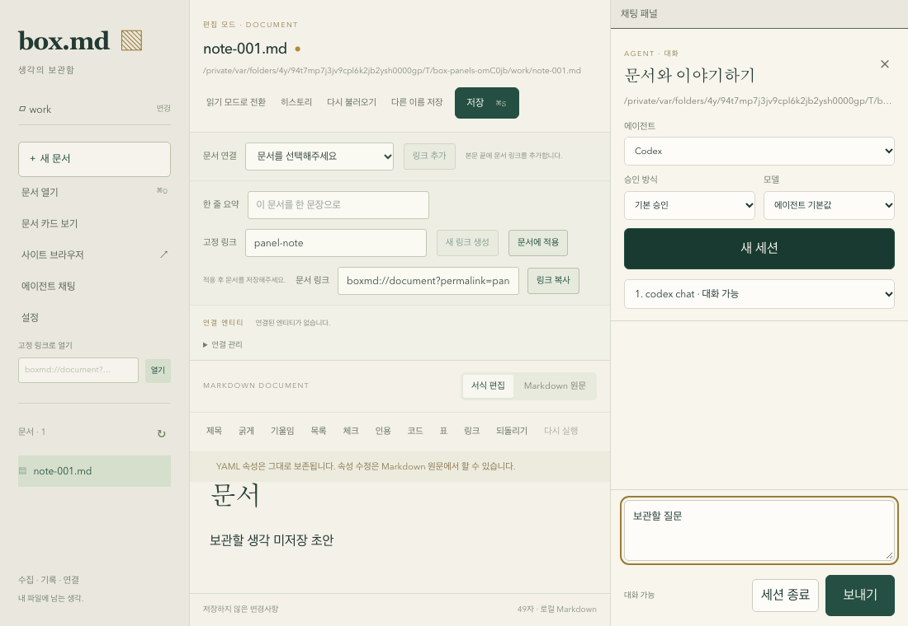
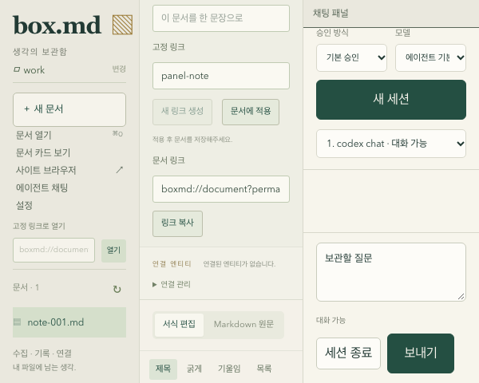

# 최우측 ACP 채팅 패널 연동 (gh-46)

문서/사이트 영역과 ACP 채팅을 하나의 가로 패널 그룹에 배치했다. 최초에는 40px 채팅 rail을 표시하며 sidebar의 에이전트 채팅, rail/패널 제목, 채팅 헤더의 닫기 버튼으로 접고 펼친다. 구분선은 포인터와 키보드로 조절하고 다시 펼치면 마지막 열린 폭을 복원한다.

## 공유 구현과 상태

- AW vendor pin: `8534a7b78a9706869b513019abe220c56ecb8281` (`box-md-ui-panels`, gh-45).
- `pnpm-workspace.yaml`에 실제 `@yoophi/ui` 패키지를 등록하고 `packages/ui`에서 component와 타입을 재내보낸다. Box 전용 패널 상태 머신이나 AW 소스 복제본은 없다.
- `react-resizable-panels`는 gh-45에서 검증한 4.11.2로 override한다. 재현 가능한 설치는 루트 lockfile로 고정한다.
- `packages/ui/src/theme.css`에서 AW component source를 Tailwind 빌드에 등록하고 기존 linen/forest 색상에 token을 매핑한다. AW globals.css 전체를 가져오지 않는다.

| 소유자 | 상태 |
| --- | --- |
| Home/기존 문서 workspace | 문서 content·baseline·dirty·읽기·pending/overwrite, 문서/사이트 전환 |
| AW shared panels | 측정 폭, 접기/펴기, 마지막 열린 폭. 중앙은 noncollapsible/showTitle false, 양쪽 keepMounted true. |
| 기존 `useAgentChat` / `AgentChatSheet` | 실제 AW HTTP/WS client, session, 대화·권한·session별 입력. 기존 sheet에 inline variant를 추가하며 같은 component identity를 유지한다. |
| SiteBrowser controller | 직렬화된 native layout intent와 ACK, modal/document 복귀 보호 |

Home의 `showChat`은 shared state 통지에서 파생되는 표시 상태다. 외부 버튼도 같은 AW controller를 사용한다. panel group을 제거하거나 재키하지 않으며 문서 key는 기존의 문서 변경 규칙을 따른다. 접기는 session cancel/close를 호출하지 않는다.

중앙은 남은 공간을 실제로 차지한다. native 사이트 bounds는 중앙 표시 영역의 현재 DOM rectangle을 사용하며 고정 drawer inset을 다시 빼지 않는다. native 사이트가 보이는 동안 sidebar/rail로 채팅을 펼치면 먼저 hide ACK를 기다린 뒤 중앙을 줄인다. modal 표시와 문서 복귀의 기존 ACK 보호도 유지한다.

좁은 컬럼에서는 document container query로 header/속성/toolbar를 감싼다. 편집 영역의 최소 높이와 문서·채팅 scroll을 유지해 600×480에서도 입력·동작 버튼에 접근할 수 있다. 좁은 창에서 원래 px 폭은 현재 양쪽 min/max에 맞게 제한된다.

## 검증의 구분

`pnpm test`의 Home DOM 흐름은 실제 AW component를 사용하되 jsdom의 없는 레이아웃/ResizeObserver는 `shared/testing/panel-layout-fixture.ts`에서 제공한다. 이것은 실제 픽셀 크기 증거가 아니다.

`tests/browser/acp-panels.spec.ts`는 실제 Chromium에서 app/editor/shared panels를 렌더링한다. 실제 AW `http_test_host`의 production HTTP/WS router와 ACP engine을 사용하고 별도 Python ACP permission fixture를 띄운다. process 생존/명시적 종료, 두 prompt, permission 보존, 채팅 draft, 동일 editor/composer DOM, 문서 undo, title/sidebar/header 토글, pointer/keyboard resize/폭 복원 및 600×480을 확인한다.

브라우저 테스트에서 문서·사이트 native IPC 경계와 연결 정보 제공만 adapter로 대체한다. 실제 macOS child WebView, 실제 설치된 provider의 응답, native 앱 재실행을 검증한 것으로 취급하지 않는다. 테스트 host·agent·임시 파일은 각 테스트의 소유한 자원만 정리한다. AW의 Vitest 전용 test-host helper는 ESM에서 `__dirname`을 사용할 수 없어 Box 테스트용 process wrapper를 두었으며 제품 ACP client는 실제 공유 라이브러리를 그대로 사용한다.

사이트·설정·연결·원문 보존·Mermaid·문서 목록의 기존 브라우저 회귀도 실행한다. 창 크기 변경은 ResizeObserver가 적용한 현재 rectangle과 native layout snapshot을 같은 poll에서 비교한다.

## 재현

```sh
pnpm install --frozen-lockfile
pnpm check-types
pnpm build
pnpm test
pnpm --filter @box/desktop test:integration
pnpm --filter @box/desktop test:browser
cargo fmt --all -- --check
cargo check --workspace --all-targets
```

설치된 실제 agent 통합 테스트는 별도 opt-in이며 기본 integration 실행에서 skip되는 항목은 통과 수에 포함하지 않는다. gh-3/gh-17 전체 완료와 native/ACP 수용 기준 전수 감사는 gh-47 및 기존 native gate를 유지한다.

## 완료 근거 (2026-10-13)

| 항목 | 결과 |
| --- | --- |
| 루트 `pnpm test` | 202개 통과: editor 43, AW HTTP client 75, AW agent facade 16, AW UI 18, desktop 50. Turbo의 기존 미변경 패키지 결과 재사용을 포함한다. |
| 브라우저 전체 회귀 | 47개 통과. 로그 `/tmp/box-md-gh46-all-browser-clean.log`. |
| 실제 HTTP/WS + ACP fixture 통합 | Home integration 1개 통과. 설치된 provider opt-in 3개는 skip이며 통과로 계산하지 않는다. `/tmp/box-md-gh46-integration.log`. |
| 타입·빌드 | `pnpm check-types`, `pnpm build` 통과. `/tmp/box-md-gh46-{types,build}.log`. |
| Rust / 재현 설치 | fmt, workspace all-targets check, frozen lockfile install 통과. `/tmp/box-md-gh46-{fmt,rust,frozen}.log`. |
| 코드 경계 | vendor worktree clean, pin `8534a7b`; Rust/SDK source는 이전 pin 대비 변경 없음. |

전체 브라우저 실행 중 ENOSPC가 발생했다. Box target의 Rust incremental 디렉터리 범위를 검증하고 생성된 `.bin/.o/.bc` 캐시 파일만 정리한 뒤 전체 47개를 다시 실행해 통과했다. 실행 앱·bundle·source·설정·사용자 문서는 정리 대상에 포함하지 않았다.

아래는 **실제 Chromium 앱 UI** 화면이다. IPC adapter/ACP fixture 기반이며 macOS native 화면 근거를 대신하지 않는다. 넓은 창에서 두 영역이 겹치지 않고 작은 창에서는 문서와 채팅 각각의 scroll로 입력·동작에 접근하는 것을 확인했다.





Box 연동 기반 gh-46의 완료 근거다. 실제 native 앱 공존/설치된 provider 응답 및 gh-17 전체 수용 기준은 gh-47과 gh-3의 native gate에서 추가 확인한다.

## gh-47 최종 수용 기준 감사 (2026-10-14)

현재 감사 기준의 AW vendor pin은 `c3aafbed7a173fd14113c1cb19f645ae97024a66`이다. 이 pin은 HTTP ACP adapter를 독립 process group으로 실행하고 세션 취소·종료 시 전체 process group을 정리한다. 위 gh-46 절의 `8534a7b`는 최초 패널 연동 당시의 고정 지점이며, 이번 감사는 현재 pin과 현재 Box 소스로 다시 수행했다.

| gh-17 기준 | 현재 구현과 검증 근거 | 판정 |
| --- | --- | --- |
| 1. 최우측 패널과 중앙 작업 영역 공존 | `HomePage`가 `@box/ui`에서 재내보낸 AW `CollapsibleResizablePanels` 안에 문서/사이트 중앙 영역과 inline `AgentChatSheet`를 같은 가로 group으로 렌더링한다. 실제 격리 macOS 앱에서 문서와 채팅, 이어서 native child WebView의 `Fixture one`과 채팅을 동시에 확인했다. | 충족 |
| 2. 명시적 접기·펴기 | sidebar의 에이전트 채팅 버튼, rail의 `채팅 패널`, 패널의 `채팅 숨기기`가 같은 shared controller를 조작한다. 실제 앱에서 응답 중 패널을 접고 rail로 다시 펼쳤다. | 충족 |
| 3. AW 공유 component와 너비 조절 | Box에는 별도 패널 구현 복제본이 없고 `packages/ui`가 AW component와 타입을 재사용한다. Chromium에서 포인터·키보드 resize를 검증했고, 실제 macOS 앱에서 splitter를 키보드로 `58.573`에서 `40`으로 변경했다. | 충족 |
| 4. 중앙 확장과 폭 복원 | 접으면 채팅 DOM을 유지한 채 중앙 영역이 rail까지 확장되고, 다시 펼치면 마지막 열린 splitter 값 `40`이 복원됐다. | 충족 |
| 5. 세션·대화·진행 응답 유지 | 실제 설치된 Codex/GPT-5.6-Sol 세션에 1부터 500까지 출력하도록 요청하고 streaming 도중 패널을 접었다. 다시 펼쳤을 때 동일한 `1. codex chat` 세션이 `응답 중`이었고, 500까지 완료된 뒤 `대화 가능`으로 돌아왔다. 대화 내용과 미전송 초안 `접기 후에도 유지할 채팅 초안`도 유지됐다. | 충족 |
| 6. 문서 내용·미저장 상태 유지 | 격리 문서에 `미저장 패널 QA 초안`을 둔 채 패널 접기·펴기, 너비 변경, 사이트 전환, 설정 modal 열기·닫기를 수행했다. `미저장 변경`과 90자 내용이 유지됐고, 임시 문자열을 추가한 뒤 `Cmd+Z`로 101자에서 90자로 복원했다. 디스크 파일 SHA-256은 실행 전후 모두 `c19390761b85dd677ab0241d2cea3bd210402687552fc51253e88202886c4cfe`였다. | 충족 |
| 7. 통합 검증 | `tests/browser/acp-panels.spec.ts` 2개가 production HTTP/WS host와 ACP permission fixture에서 통과했다. 실제 macOS 앱에서는 로컬 fixture `http://127.0.0.1:50344/one`의 child WebView와 채팅을 함께 표시하고, 설정 modal이 remote view 위에 가려지지 않는 것을 확인했다. 세션 종료 후 `codex-acp`/`npx codex-acp` 잔류 process가 없었다. | 충족 |

브라우저 검증은 DOM identity, 문서 undo, 채팅 draft, pointer/keyboard resize, collapse/restore, 좁은 viewport, 실제 HTTP/WS ACP lifecycle을 담당한다. native 검증은 Chromium adapter로 대체할 수 없는 macOS child WebView bounds와 modal 보호, 설치된 Codex의 실제 streaming, 앱 내 상태 보존을 담당한다. 두 범위를 합쳐 gh-17 기준 1~7을 모두 확인했다.

## gh-17 완료 판정

부모 기능의 의존 작업 `gh-3`, `gh-44`, `gh-45`, `gh-46`, `gh-47`이 모두 `closed`인 것을 td에서 확인했다. 공유 component 계약과 AW 확장, Box facade와 화면 연동, 실제 HTTP ACP 채팅, native runtime 감사가 각각 완료됐으며 위 표에서 기준 1~7에 대응하는 직접 근거를 확인했다.

따라서 최우측 ACP 패널 기능은 현재 source와 vendor pin에서 완료로 판정한다. 이후 문서 MCP 주입(`gh-20`)과 사이트 브라우저 전체 감사(`gh-4`)는 이 패널의 완료 조건과 분리된 상위 기능으로 계속 추적한다.
