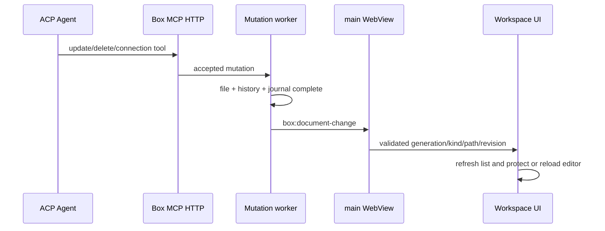

# 문서 변경 이벤트 통합 감사 (gh-84)

## 실행 경로



실제 HTTP mutation은 application의 고정 scope와 accepted worker를 지나 파일, Git history, journal이 끝난 뒤 event sink를 한 번 호출한다. Tauri adapter 실행 검사는 직렬화된 payload가 `EventTarget::webview("main")` listener에 도착하고 다른 WebView listener에는 도착하지 않는지 확인한다. 프런트엔드 adapter는 같은 event 이름을 구독하고 payload를 검증한 뒤 workspace model과 관계 model로 전달한다.

## 기준별 실행 근거

| 기준 | 실행 증거 | 확인 결과 |
| --- | --- | --- |
| 실제 backend mutation | `http_mutations_publish_once_after_history_and_never_publish_failed_or_replayed_requests` | 실제 HTTP create/delete/connection이 성공 완료 뒤 각각 한 번 발행된다. CAS 실패와 같은 request ID 재호출은 추가 발행하지 않는다. |
| 응답 유실과 drain | `disconnected_granted_mutation_survives_revoke_and_root_switch_drains_before_new_grant`, `shutdown_stops_http_admission_then_drains_an_accepted_disconnected_write` | TCP 응답 유실 뒤에도 accepted mutation과 event가 완료되고 root/종료 barrier가 이를 기다린다. |
| main 전용 전달 | `emitted_change_reaches_main_and_not_another_webview` | 실제 Tauri mock runtime에서 main WebView만 payload를 수신하고 site-browser WebView는 수신하지 않는다. |
| clean 문서와 undo 경계 | `applies an external MCP change to a clean document and uses its new revision on save` | event revision과 disk revision이 같을 때 content, baseline, revision과 editor key를 함께 교체한다. 다음 저장은 새 revision을 사용한다. |
| dirty 문서와 저장 충돌 | `keeps a dirty editor instance and draft when MCP changes or deletes the open document`, `saves a dirty external change with the old revision and preserves the draft on conflict` | editor instance와 초안, baseline, 기존 revision을 유지한다. 저장은 기존 revision으로 CAS를 수행하고 conflict 뒤에도 초안을 유지한다. |
| 삭제 | clean/dirty deletion 회귀 | 목록에서는 제거하되 열린 내용은 복구할 수 있도록 유지하고 상태별 안내를 표시한다. |
| 관계 | `reloads the graph only for a connection event in the current generation` | 현재 generation의 `connectionsChanged`만 관계 목록을 다시 읽는다. |
| 중복·경합 | nonce replay, pending refresh, save 중 event 회귀 | backend 중복 발행을 막고, 조회 중 두 번째 event와 busy 중 event를 후속 처리한다. |
| stale async·root 격리 | `ignores stale generations and an external read that finishes after user input`, `real_grants_retry_one_credential_revoke_only_one_run_and_follow_new_root_generations` | 이전 generation과 늦은 read를 버리고, root 전환 뒤 이전 grant와 event가 새 화면에 적용되지 않는다. |
| 비밀정보 | backend payload serialization 회귀와 frontend validator | content, request ID, 절대 root, credential은 event에 포함하지 않으며 비정상·과대 payload를 버린다. |

## 검증 명령

```sh
cargo test --manifest-path apps/box-desktop/src-tauri/Cargo.toml
pnpm --filter @box/desktop test
pnpm check-types
pnpm build
cargo fmt --manifest-path apps/box-desktop/src-tauri/Cargo.toml --check
cargo check --manifest-path apps/box-desktop/src-tauri/Cargo.toml
```

Rust와 React 검사는 event 생성·main 전용 전달·화면 반영의 각 실행 경계를 실제 코드로 통과한다. 운영 Tauri 프로세스에서 ACP agent까지 포함한 설치 환경 검증은 설치 agent/native 전체 gate인 gh-53의 범위로 유지한다.
