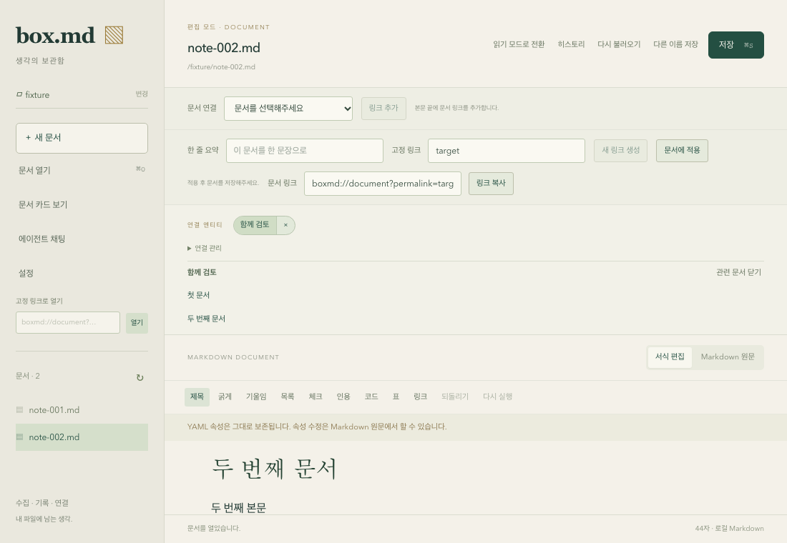

# 명시적 문서 연결 (gh-19)

본문 wikilink와 독립된 연결 엔티티와 소속 관계를 제공한다. 연결 엔티티에는 UUID와 이름을, 연결 관계에는 엔티티 ID와 문서 permalink를 저장한다. 문서 제목·파일 경로·작업 디렉터리를 관계의 식별자로 사용하지 않는다. 같은 permalink는 같은 논리 문서의 연결 관계를 가리키며, 파일 목록에서 중복되면 이동 대상을 임의로 선택하지 않는다.

연결 데이터는 앱 데이터 디렉터리의 `connections.json`에 별도로 보관한다. 따라서 문서의 이름이나 위치가 바뀌어도 관계를 유지하며, 본문 wikilink 작성·삭제는 관계를 생성·삭제하지 않는다. 관련 문서의 실제 파일은 현재 작업 디렉터리에서 permalink로 해석한다. 그 범위에 없거나 중복되면 상태를 표시하고 임의로 열지 않는다.

## 실행 순서

| 작업 | 범위 | 의존성 |
| --- | --- | --- |
| gh-35 | Rust 도메인·원자적 저장소·Tauri/TypeScript 계약 | gh-13 |
| gh-36 | 문서의 엔티티 표시·연결/해제·관련 문서 탐색 UI | gh-35 |
| gh-37 | 다대다·부분 해제·파일/본문 유지·복원 전수 감사 | gh-36 |

상위 gh-19는 gh-37에 의존한다. 하위 작업마다 필요한 검증과 커밋을 완료하고 순서대로 진행한다. 문서 화면과 전수 감사가 완료되기 전까지 상위 작업은 완료 처리하지 않는다.

## 저장 계약

버전 1 JSON은 `version`, `entities`, `memberships`를 갖는다. 엔티티는 `id`와 `name`, 관계는 `connectionId`와 `permalink`로 표현한다. 하나의 엔티티/문서 쌍은 한 번만 존재하며 반복 연결·해제는 동일한 결과를 낸다. 관계 해제는 해당 쌍만 제거하고 엔티티·문서·다른 관계를 유지한다. 이름은 앞뒤 공백을 제거한 비어 있지 않은 한 줄 텍스트이며 이름 중복은 구분 가능한 오류로 처리한다.

저장소의 변경은 잠금 아래 읽기→도메인 변경→검증→원자적 파일 교체로 수행한다. 잠금 파일과 데이터 파일은 구분하여 데이터 파일 교체 중에도 같은 잠금을 유지한다. 손상 데이터, 지원하지 않는 버전, 잘못된 관계는 오류로 알리고 원본을 덮어쓰지 않는다. 잠금 구현은 설치된 Rust 1.99의 [표준 File::lock](https://doc.rust-lang.org/std/fs/struct.File.html#method.lock)을 사용한다.

## 저장소 구현과 검증 (gh-35)

Rust `connection` 도메인은 엔티티/관계와 불변 조건을, `ConnectionRepository` port는 조회 및 잠금 아래의 단일 변경 계약을 제공한다. `ConnectionService`는 UUID 생성과 생성·연결·해제 동작을 담당한다. 파일 adapter는 독립 잠금 파일에 프로세스 간 잠금을 걸고 최신 데이터를 읽은 뒤 변경을 적용한다. 임시 파일을 동기화하고 같은 디렉터리에서 교체한다. 잘못된 버전·중복·유실된 엔티티를 가리키는 관계·알 수 없는 필드를 거부한다. 오류나 중단된 변경은 원본 파일을 유지한다.

Tauri 계약은 `list_connections`, `create_connection_entity`, `attach_document_connection`, `detach_document_connection`이다. 모든 응답은 공용 TypeScript `ConnectionSnapshot`과 같은 전체 snapshot이다. 저장소는 앱 시작 시 같은 앱 데이터 디렉터리로 구성하고 요청마다 파일에서 읽으므로 재시작에서 연결을 복원한다. 잠금/파일 I/O는 blocking worker에서 실행한다. 현재 main webview와 로컬 앱 origin만 허용하며 비동기 작업 뒤에도 요청 화면을 다시 확인한다.

실제 임시 파일을 사용하는 native 검증 6개가 통과했다. 엔티티 UUID 식별, 독립 생성, 다대다 연결/중복 idempotency, 부분 해제 후 다른 엔티티·관계·문서 유지, 새 저장소 인스턴스에서 복원, 다른 디렉터리로 문서를 이동하고 제목/본문 wikilink를 변경한 뒤 연결 파일 불변, 손상/미래 버전/불일치 데이터와 실패한 변경 보존, opaque permalink가 파일 경로가 되지 않음을 확인한다. 동시 저장 검증은 별도 테스트 프로세스 두 개가 각각 12개의 엔티티와 관계를 만들고 24개 모두 남는지 확인한다. peer worker는 일반 실행에서 제외하며 부모 테스트가 소유한 임시 디렉터리로 명시적으로 실행한다.

상위 기능의 전체 복원/문서 탐색/미저장 보호 수용 기준 감사는 gh-37에 남아 있다. native 저장소 테스트를 실제 macOS 화면 검증으로 확대 해석하지 않는다.

## 문서 화면 (gh-36)

문서 속성 아래에 현재 문서의 연결 엔티티를 표시한다. 이름을 누르면 관련 문서 목록을 열고 `×`는 해당 문서와 엔티티의 관계만 해제한다. 연결 관리에서는 문서 없이 독립 엔티티를 생성하거나 기존 엔티티를 현재 문서에 연결할 수 있다. 연결 후 관리 폼은 접혀 본문 공간을 돌려주며 연결 표시는 패널 스크롤 중에도 유지한다.

관계의 문서 식별자는 저장된 baseline의 permalink를 사용한다. 아직 저장하지 않은 문서나 고정 링크가 없는 문서는 안내를 표시하고 연결을 비활성화한다. 고정 링크 변경이 미저장 상태이면 기존 연결은 보여주되 관계를 변경하지 않는다. 일반 본문 편집은 관계를 변경하지 않으므로 미저장 초안을 유지하며 연결할 수 있다. 저장소를 읽지 못하면 기존 표시를 유지하고 쓰기를 막으며 다시 읽을 수 있다. 이전 문서의 늦은 완료는 새 문서의 연결이나 완료 안내로 적용하지 않는다.

`entities/document/use-document-targets.ts`는 본문 wikilink와 명시적 연결 화면의 문서 식별 조회를 공유한다. `resolveDocumentTargets`의 제목·누락·중복·부분 목록 판정을 사용하지만 관계 저장 모델은 공유하지 않는다. 관련 문서 이동은 기존 `workspace.request({type: "permalink"})` 경로로 요청해 저장·버리기·취소 보호를 유지한다. 누락·중복·조회 실패의 문서는 상태를 표시하고 이동 버튼을 비활성화한다.

desktop 검증 39개에는 독립 생성, 부분 연결/해제, 미저장 식별자 보호, 이전 문서 완료 무시, 저장 오류/재시도 5개가 추가됐다. 실제 Chromium 33개 중 5개는 두 문서의 엔티티 공유와 미저장 이동 3분기, 미저장 ID와 부분 해제, 누락/중복 대상 표시를 검증한다. 연결 작업 자체로 문서 쓰기가 발생하지 않음을 확인한다. 공용 43개, SDK 75개, facade 16개 및 기본 검사도 통과했다. 실제 HTTP ACP 통합 1개도 통과했고 설치 에이전트 3개는 이 실행에서 제외했다.

브라우저의 문서 및 연결 저장 IPC는 native test adapter를 사용한다. 실제 저장소의 동시/복원/본문 독립 검증은 gh-35의 native 테스트를 별도로 사용하며 macOS 실제 창 검증이라고 확대하지 않는다. 앱 초기화 복원, 제목/경로 변경 및 본문 wikilink 변경 후 관계 불변을 포함하는 상위 기준 전수 검증은 gh-37에서 수행한다. 로그는 `/tmp/box-md-gh36-{types,tests,browser,build,fmt,rust,integration}.log`에 저장했다.
