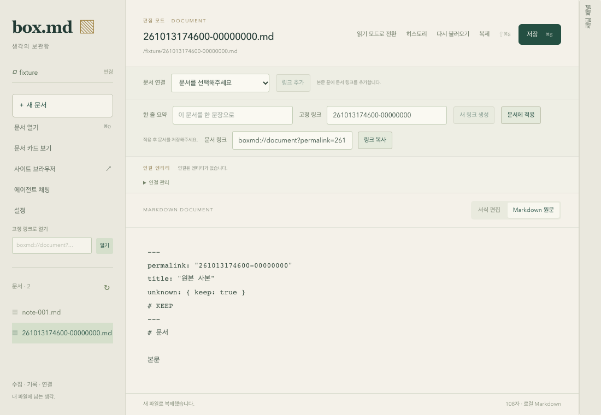

# ID 문서 생성·복제 UI (gh-67)

새 문서를 저장하면 선택한 작업 디렉터리에 backend가 결정한 `{permalink}.md`를 생성한다. 임의 파일명 picker·다른 이름 저장·기존 대상 덮어쓰기 dialog를 제거했다. 기존 문서의 일반 저장은 현재 path/revision과 Git 이력 경로를 유지한다. 저장 전 새 문서의 고정 링크 입력/복사는 비활성화하고 먼저 저장하도록 안내한다.

문서의 `복제` 버튼과 `⇧⌘S`/`Ctrl+Shift+S`는 [공통 native 생성·복제 계약](document-creation-duplication-service.md)을 사용한다. 읽기 모드에서도 저장된 작업 루트 문서를 복제할 수 있고 새 파일은 편집 모드로 열린다. 현재 dirty 원문을 복사해도 원본을 자동 저장하지 않는다. 결과는 문서 목록과 열린 문서에 반영된다. native File 메뉴에는 Save As 항목이 없으며 main의 `dialog:allow-save` permission도 제거했다.

## 상태와 재시도

요청의 문서 key/path/content/revision 및 작업 루트 path/generation을 캡처한다. 성공 응답이 현재 상태와 일치할 때만 새 문서/baseline을 적용한다. unmount/다른 root·이전 문서의 늦은 결과는 현재 편집기를 교체하지 않는다. 실패 시 내용·baseline·편집기 인스턴스를 유지한다. 일반 저장과 목록 refresh에도 현재 문서/root 및 mounted guard를 적용했다.

동일 내용/문서/root의 transport 재시도는 같은 requestId를 사용해 최초 생성 결과를 다시 받는다. terminal application 오류 또는 입력 변경은 새 시도다. busy 중 editor와 작업 버튼은 잠기며 실패 후 rich editor undo를 사용할 수 있다. 설정 변경·문서 이동·읽기 전환의 기존 저장/버리기/취소 보호를 유지한다.

기존 문서에 ID가 없을 때 첫 일반 저장·본문 링크 대상 식별·속성의 `새 링크 생성`도 로컬 날짜 12자리와 Web Crypto 4 byte hex 8자리 형식을 사용한다. 기존 UUID/사용자 ID와 파일명은 바꾸지 않는다. 자동 부여의 native duplicatePermalink 거부에는 새 난수로 최대 32회 재시도한다. 사용자가 명시적으로 설정한 ID를 충돌 때문에 자동 교체하지 않는다.

## 검증

| 검증 | 이번 결과와 범위 |
| --- | --- |
| TypeScript unit | 총 244개 결과. desktop 61개는 현재 실행, 미변경 4개 package task는 Turbo cache 재사용. 신규 생성·dirty 복제·title/fallback·실패 후 editor 보존·응답 유실 재시도·다른 root remount의 늦은 응답·legacy ID 충돌/속성 생성·로컬 날짜/OS random 실패를 포함 |
| 실제 Chromium | 전체 51개 통과. 신규 4개는 Save As 부재/ID 파일/Shift 복제, 읽기 모드 및 BOM/CRLF/본문/source 보존, 실제 rich undo, 응답 유실 뒤 같은 requestId/파일 1개를 검사. 600×480에서 복제 버튼 접근과 1100×760 화면도 확인 |
| Rust 앱/IPC | 68개 통과, helper 1개 ignored 및 subprocess 3회 각각 통과. 새 command의 실제 파일 생성/복제 및 main 권한·child 거부가 포함됨 |
| 기본 검사 | types/build/Rust fmt/workspace all-targets 모두 exit 0. 문서 링크·diff 검사 완료 |

브라우저의 문서 IPC/파일은 [테스트 adapter](../apps/box-desktop/tests/browser/native-fixture.ts)다. UI가 실제 native 파일을 변경하는 증거는 gh-66/이번 Rust IPC 검사에서 별도로 확인한다. 현재 macOS 앱 번들을 새로 실행한 것으로 계산하지 않는다. 실제 native/agent MCP 사용은 gh-51~53과 기존 native gate에 유지한다. Playwright runtime이 없어 첫 실행이 시작하지 못한 뒤, 프로젝트 버전에 맞는 headless Chromium/FFmpeg를 설치해 다시 실행했다. 기존 browser cache와 사용자 앱은 제거하지 않았다.

로그: `/tmp/box-md-gh67-{tests,ui-tests,browser,creation-browser,types,build,native-tests,fmt,rust}.log` 및 frontend/native check JSON. 앱 dead-code 경고 8개와 기존 AW/빌드 chunk 경고는 남아 있다. 외부 AgentChatSheet 두 파일은 커밋에서 제외한다.

소스: [공용 응답](../packages/contracts/src/index.ts), [native 호출](../apps/box-desktop/src/entities/document/api.ts), [상태/재시도](../apps/box-desktop/src/features/manage-document/model/use-document-workspace.ts), [도구 모음](../apps/box-desktop/src/pages/home/ui/HomePage.tsx), [고정 링크 속성](../apps/box-desktop/src/features/document-properties/ui/DocumentProperties.tsx), [unit](../apps/box-desktop/src/pages/home/ui/HomePage.test.tsx), [browser](../apps/box-desktop/tests/browser/document-creation.spec.ts).

gh-67은 UI 연동 단위다. gh-64 기준1~7 최종 감사는 gh-68에서 수행한다. 문서 MCP handler/HTTP와 ACP 주입/실제 사용 검증은 gh-51~53에서 이 계약을 사용한다.
