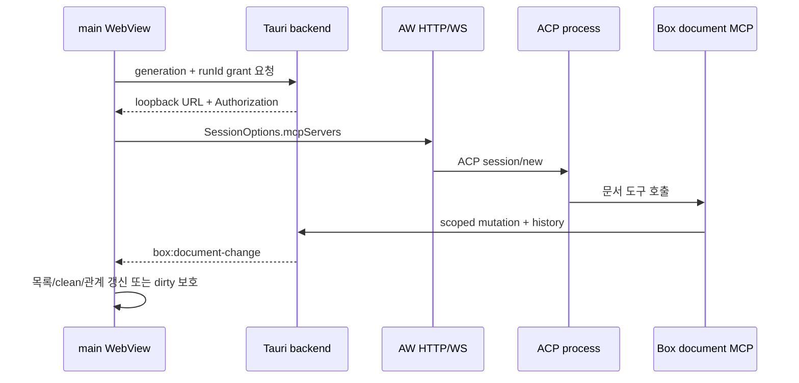

# native MCP·ACP·UI 통합 감사 (gh-78)

2026-10-14 기준으로 gh-52의 native host/grant, AW HTTP ACP 주입, main UI 변경 반영을 한 흐름으로 대조했다. 이후 gh-53의 [실제 설치 agent·native 감사](document-mcp-native-agent-audit.md)에서 배포 native 앱의 최종 검증을 완료했다.

## 통합 경로

## gh-52 기준별 근거

| 수용 기준 | 소스와 실행 근거 | 판정 |
| --- | --- | --- |
| 실제 AW HTTP/WS와 ACP `session/new` | `document-chat-sessions.integration.test.jsx`가 실제 공유 Workbench 서버와 Python ACP subprocess를 실행한다. Box HTTP MCP URL/header와 AW 기본 MCP가 `session/new`에 함께 도달한다. | 통과 |
| unsupported HTTP capability와 채팅 유지 | 실제 ACP initialize가 HTTP 미지원을 반환하는 fixture에서 AW diagnostic을 수신하고 grant를 폐기한다. 같은 session은 ready 일반 채팅을 유지하며 UI에서 다음 session의 문서 도구 연결 여부를 선택할 수 있다. | 통과 |
| grant/revoke와 새 root 격리 | `real_grants_retry_one_credential_revoke_only_one_run_and_follow_new_root_generations` 및 disconnect/root drain 회귀가 run별 credential, 독립 폐기, 이전 generation 401, 새 root 파일 격리를 실제 HTTP로 확인한다. | 통과 |
| main command와 child ACL | `main_grant_command_uses_selected_generation_and_child_cannot_issue_or_revoke`가 compiled manifest/capability에서 main의 발급·폐기와 child WebView 거부를 실행한다. 늦은 grant 결과는 generation rebind 뒤 공개되지 않는다. | 통과 |
| session 수명과 오류 복구 | 생성 실패·불확실 결과, EOF/lost/close, root 변경, disposal에서 소유 grant를 폐기한다. 폐기 실패는 pending cleanup으로 남겨 재시도하며 고정된 진단만 노출한다. 패널 collapse와 transient stream error는 session/grant를 유지한다. | 통과 |
| clean 문서 갱신 | 성공 mutation은 file/history/journal 완료 뒤 main 전용 event를 한 번 발행한다. 현재 generation의 열린 clean 문서는 event revision과 disk revision이 일치할 때 content, baseline, revision과 editor key를 교체한다. | 통과 |
| dirty·undo·삭제·저장 충돌 | dirty editor의 content, instance/key, undo, baseline, revision을 유지하고 외부 변경을 알린다. 삭제도 내용을 복구 가능하게 유지한다. 저장은 기존 revision으로 CAS를 수행하고 conflict 뒤 초안을 보존한다. | 통과 |
| 동시 저장·stale async·root 변화 | busy 중 event queue, 조회 중 pending refresh, 늦은 read, 이전 generation, 늦은 grant/session result를 버리는 회귀가 있다. root 전환은 accepted mutation drain 이후 새 grant를 발급한다. | 통과 |
| 중복과 비밀정보 | 같은 request ID 재호출은 event를 다시 발행하지 않는다. payload와 공개 chat snapshot/error에는 content, request ID, 절대 root, bearer token을 넣지 않는다. frontend validator는 절대·상위 경로와 과대/잘못된 payload를 버린다. | 통과 |

## 실행 결과

- `pnpm --filter @box/desktop test:integration`: 7 passed, 설치 agent용 3개 opt-in test skipped.
- `pnpm test`: 102 passed. 문서 session lifecycle, main clean/dirty/delete/concurrency/stale UI와 관계 갱신 포함.
- `cargo test --manifest-path apps/box-desktop/src-tauri/Cargo.toml`: 97 passed, 1 ignored. 실제 MCP HTTP, grant/root/drain, compiled Tauri ACL, main 전용 event 포함.
- `pnpm check-types`, `pnpm build`, `cargo fmt --check`, `cargo check`: 통과. build의 기존 bundle size warning과 Rust dead-code warning만 남는다.

## 범위

이번 감사는 공유 AW 서버·실제 ACP subprocess, native HTTP/IPC/Tauri mock runtime, React main 화면의 실행 경계를 결합한다. 실제 설치 agent가 HTTP MCP capability를 광고하고 배포 native 앱에서 도구를 호출하는 최종 화면 증거는 [gh-53 감사](document-mcp-native-agent-audit.md)에서 별도로 확인했으므로 fixture 결과를 설치 agent 검증으로 확대하지 않는다.

관련 문서: [native grant](document-mcp-native-grants.md), [ACP 연결 감사](document-mcp-acp-acceptance.md), [변경 event 감사](document-change-integration-audit.md), [구현 계획](document-mcp-native-integration-plan.md).
