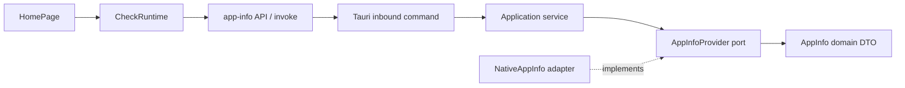

# 초기 아키텍처

## 구성

| 경로 | 책임 |
|---|---|
| `apps/box-desktop` | React WebView와 Tauri 네이티브 앱 |
| `packages/contracts` | 앱·공용 코드에서 사용하는 TypeScript DTO |
| `packages/ui` | 공용 React 컴포넌트와 Tailwind 테마 |
| `crates` | 향후 실제 공유할 Rust crate를 위한 영역 |
| 루트 Cargo workspace | 현재 Tauri 앱 crate 포함 |

AW의 pnpm/Turbo + Cargo workspace, FSD, 헥사고날 계층을 채택했다. 현재 하나의 앱이므로 독립 서버·CLI·ACP는 필요할 때 추가한다.

## 실행 경계

- 브라우저 영역은 시작 화면과 사용자 입력, 상태·오류 표시를 담당한다.
- Rust 영역은 실제 플랫폼·버전 조회를 담당한다. Tauri command는 application service에 위임한다.
- DTO는 Rust `domain::AppInfo`와 TypeScript `@box/contracts`에서 정의한다. 자동 생성은 아직 도입하지 않았다.
- 일반 브라우저 미리보기는 IPC를 흉내 내지 않고 미리보기 상태를 표시한다.
- 기본 개발 포트는 AW의 1420과 충돌하지 않도록 1430을 사용한다.
- `packages/ui`는 소스를 직접 export하므로 소비 앱의 Vite가 번들링한다. Turbo는 각 패키지의 타입 검사와 의존 순서를 관리한다.

## 참고

- 기존 `agentic-workspace/AGENTS.md`, pnpm·Turbo·Cargo 설정과 AW의 Vite/Tauri 설정을 참고했다.
- [Tauri command](https://v2.tauri.app/develop/calling-rust/), [Tauri build 설정](https://v2.tauri.app/reference/config/)을 기준으로 구성했다.

## 초기 검증 — 2026-10-12

- `pnpm install`: 완료, pnpm 잠금 파일 생성.
- `pnpm check-types`: 공용 패키지 2개와 desktop 앱 통과.
- `pnpm build`: 프런트엔드 프로덕션 번들 생성.
- `cargo check --workspace --all-targets`, `cargo fmt --all -- --check`: 통과.
- `pnpm tauri:build --debug --no-bundle`: 네이티브 실행 파일 생성.
- `pnpm tauri:build --debug --bundles app`: `target/debug/bundle/macos/box.md.app` 생성.
- 앱 실행 후 “앱 정보 확인” 버튼 클릭: `box.md · v0.1.0 · macos` 표시, WebView→Rust→WebView 호출 확인.
- GitHub Actions는 설정만 추가했으며 원격 실행은 수행하지 않았다. 릴리스 서명·공증은 초기 검증 범위에 포함하지 않는다.

## 문서 편집·작업 디렉터리 확장

`gh-2`에서 공용 `packages/editor`, 작업 디렉터리 문서 탐색, native document open/save command와 파일 revision 검사를 추가했다. 현재 상세 구조·수용 범위·검증은 [문서 편집 기록](document-editing-gh-2.md)을 기준으로 확인한다.
