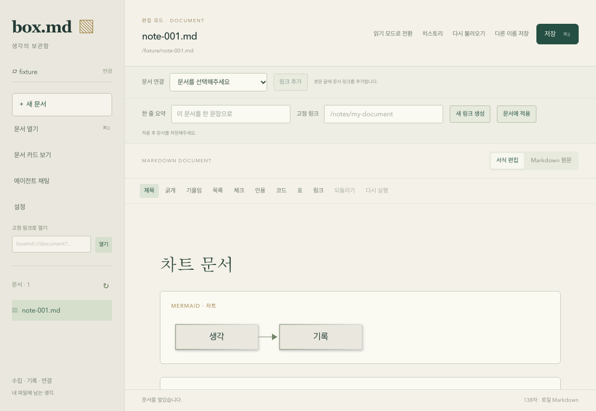

# Mermaid 문서 편집기 (gh-16)

Mermaid fenced code는 공용 `packages/editor`의 `mermaidBlock` leaf atom으로 읽는다. Mermaid DSL은 편집 가능한 ProseMirror 텍스트 대신 `source` 속성에 보관하고, 저장할 원문은 `raw` 속성에 보관한다. 보기·서식 편집에서 차트 내용을 직접 수정하지 않으며 Markdown 원문 모드에서 수정한다.

## 원문 보존 (gh-29)

Mermaid 노드가 일반 코드 블록보다 먼저 Markdown `code` 토큰을 처리한다. 다른 언어의 코드 블록은 StarterKit CodeBlock을 확장해 처리한다. 코드 내용에 펜스가 있으면 더 긴 펜스를 선택해 뒤의 실제 차트가 일반 코드로 흡수되지 않게 한다. serializer는 차트의 `raw`를 사용하므로 Mermaid 문법, 공백, Unicode, 백틱/물결 펜스 길이와 언어 표기를 보존한다. Marked가 정규화한 줄바꿈은 모든 실제 코드 토큰을 순서대로 추적해 입력의 대응하는 원문 행에서 복원한다. 다른 코드 안의 예시에는 차트 복원을 적용하지 않는다. 인용문·목록의 컨테이너 접두사는 Markdown serializer가 처리한다.

확장 문법 검사는 fenced code와 inline code를 제외하고 수행한다. Mermaid 내부 HTML 형태의 라벨이나 `$` 때문에 문서 전체가 원문 모드로 강제되지 않는다. HTML clipboard 내보내기는 실행 가능한 SVG 대신 이스케이프된 코드 텍스트를 사용한다. 외부 clipboard의 raw 속성은 같은 Mermaid 코드 블록과 원문인지 검증한다.

공용 테스트 25개와 기존 desktop 27개, Chromium 회귀 13개 및 프로젝트 기본 검증이 통과했다. Mermaid 전용 10개 검증에는 여러 블록, Unicode, CRLF/혼합 줄바꿈, 백틱/물결 펜스, 인용문, 주변 본문 수정, 코드 문법 검사 제외, leaf atom schema가 포함된다. 일반 코드 안의 Mermaid 예시를 실제 차트와 구별하며, 인용문과 목록이 결합된 경우 schema와 저장·재열기 원문을 확인했다. BOM만 있는 문서는 BOM을 별도 prefix로 보존한다.

## 차트 렌더러 (gh-30)

Mermaid 12.1.0과 DOMPurify 3.4.17을 첫 차트에서 지연 로딩한다. `securityLevel: strict`, `htmlLabels: false`, `secure` 설정으로 문서 지시문이 보안을 낮추지 못하게 한다. 출력은 SVG 프로파일로 정제하고 실행 가능한 태그와 외부 href를 제거한다. Mermaid callback 바인딩은 사용하지 않는다. 최종 SVG는 Shadow DOM에 넣어 차트 스타일을 문서 UI에서 분리한다.

측정용 임시 DOM은 성공·실패 모두 정리한다. NodeView는 소스 변경마다 generation을 갱신해 이전 결과를 무시하며, 삭제한 뷰에는 결과를 적용하지 않는다. 오류는 해당 차트 블록에만 표시하고 문서의 나머지는 유지한다. 원문 크기 50,000자와 500 edge 제한을 사용한다. 렌더링 한도로 표시하지 못해도 저장할 원문은 유지한다.

Mermaid가 일반 문단 대신 기본 블록으로 선택되지 않도록 schema에서 paragraph 순서를 유지하면서 Mermaid 파서를 일반 코드 파서 앞에 등록한다. 본문 편집·원문 전환에서 빈 차트가 생기는 회귀를 검증했다.

공용 28개(보존 10개 및 NodeView 수명 3개 포함), desktop 27개, 실제 Chromium 16개가 통과했다. 실제 렌더링 검증 3개는 여러 차트/독립 오류, 두 모드 비편집·주변 편집/원문 갱신, 보안 지시문/HTML 이벤트/JavaScript 링크를 다룬다. unsafe 입력 검증에서 실행·외부 요청·외부 href가 발생하지 않았다.

## 통합 검증 (gh-31)

`apps/box-desktop/tests/browser/mermaid-render.spec.ts`의 Chromium 7개 검증은 실제 React 화면과 Tiptap 편집기, Mermaid SVG 렌더러를 사용한다. 폴더/문서 읽기·쓰기 IPC만 메모리 기반 native adapter로 대체한다. 저장 버튼이 전송한 내용을 확인한 뒤 다른 문서를 열었다가 원래 문서를 다시 열어 저장된 내용과 차트를 확인한다. macOS 창이나 실제 파일 쓰기 검증을 이 브라우저 검증으로 대신했다고 주장하지 않는다.

| gh-16 수용 기준 | 확인 근거 |
| --- | --- |
| 1. 보기·서식 모드 및 여러 차트 | 두 모드에서 flowchart/sequenceDiagram의 SVG와 각 블록 상태를 확인한다. 유효한 두 차트와 잘못된 차트가 함께 있는 문서도 확인한다. |
| 2. 차트 비편집·주변 본문 편집 | figure의 `contenteditable=false`, 읽기 모드의 본문 `contenteditable=false` 및 원문 textarea의 readonly를 확인한다. 서식 모드에서 실제 키 입력으로 주변 본문을 수정한다. 공용 schema 검증은 차트가 자식 텍스트 없는 leaf atom임을 확인한다. |
| 3. 원문 수정 후 갱신 | 원문에서 라벨을 바꾸고 서식 모드에서 갱신된 SVG를 확인한다. 오류 차트를 유효한 DSL로 고친 뒤 서식·읽기 모드에서 새 SVG를 확인한다. |
| 4. 전환·주변 수정·저장·재열기 보존 | BOM과 기존 frontmatter, CRLF/혼합 줄바꿈, 긴 백틱/물결 펜스, 목록 안 인용 차트를 검증한다. 저장 payload의 차트 원문과 펜스를 확인하고 다시 연 문서의 원문을 저장 payload와 비교한다. 기존 permalink를 가진 frontmatter는 그대로 유지한다. 새 문서는 기존 규칙대로 permalink를 추가한다. 목록 마커 배치는 serializer가 정규화하며 코드 행과 펜스의 내용·줄바꿈은 유지한다. |
| 5. 블록 오류 및 원문 복구 | 잘못된 블록만 오류를 표시하고 다른 차트와 마지막 본문이 유지된다. 원문 수정 후 오류가 사라지고 새 차트가 읽기 모드에서도 표시된다. 측정용 임시 DOM이 남지 않는다. |
| 6. 안전한 렌더링 | 보안을 낮추려는 init 지시문, HTML 이벤트 라벨, JavaScript 링크를 입력한다. 실행 가능한 태그·이벤트 속성·외부 href, script 실행, 외부 요청이 없음을 확인한다. 렌더러는 strict 설정을 보호하고 DOMPurify로 SVG를 정제하며 callback을 바인딩하지 않는다. |
| 7. 검증과 기본 검사 | `pnpm check-types`, `pnpm test`, `pnpm --filter @box/desktop test:browser`, `pnpm build`, `cargo fmt --all -- --check`, `cargo check --workspace --all-targets`를 실행한다. |

현재 공용 편집기 28개, desktop 27개, SDK 75개, chat facade 16개와 Chromium 20개가 통과한다. Chromium 중 7개가 Mermaid 통합 검증이며 나머지 13개는 설정/사이드바 회귀 검증이다. NodeView 테스트 3개는 오래된 렌더 결과·삭제된 뷰·개별 실패 격리를 검증한다. 기존 실제 HTTP ACP 통합 검증 1개도 gh-30에서 통과했다.

상위 gh-16 검토에서 `cargo test -p box-desktop`의 native 테스트 15개도 통과했다. 실제 임시 파일을 사용하는 Unicode 저장·재열기, 외부 변경 충돌, Git history 및 원본 보존을 확인한다. 파일 저장 구현은 전달받은 UTF-8 바이트를 쓰며 Markdown 또는 Mermaid를 재해석하지 않는다. Mermaid의 펜스·줄바꿈 보존은 공용 파서와 위 Chromium 저장 payload 검증에서 직접 확인한다. native 테스트 로그는 `/tmp/box-md-gh16-native-tests.log`에 있다.

검증 실행 로그는 `/tmp/box-md-gh31-{types,tests,browser,build,fmt,rust}.log`에 저장했다. 브라우저의 앞선 세부 실행은 `/tmp/box-md-gh31-mermaid.log`에 있다. 전체 요구사항의 영구 근거는 이 문서와 커밋된 테스트이며 임시 로그에만 의존하지 않는다.

참조: [Tiptap JavaScript node views](https://tiptap.dev/docs/editor/extensions/custom-extensions/node-views/javascript), [Mermaid 보안 설정](https://mermaid.js.org/config/schema-docs/config.html#securitylevel).
