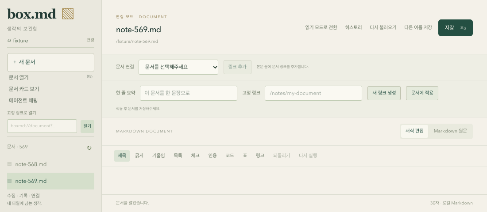

# 사이드바 문서 목록 스크롤 복구 (gh-15)

문서가 많으면 자동 그리드 행의 최소 높이가 목록 전체 높이를 수용하도록 늘어났다. 569개 문서에서 목록의 `clientHeight`와 `scrollHeight`가 모두 21,622px이 되어 내부 스크롤이 발생하지 않았고, 작은 창에서는 하단 안내가 창 밖으로 밀렸다.

그리드 행을 `minmax(0, 1fr)`로 제한하고 사이드바·중앙 영역에 `min-height: 0`을 적용했다. 목록 영역만 남은 공간을 차지하고 스크롤하며 상단 조작과 하단 안내는 축소되거나 밀리지 않는다. 640px 이하 및 520px 이하 창에서는 여백을 줄인다. 긴 작업 디렉터리 이름은 한 줄로 줄여 표시하고 전체 경로는 툴팁으로 확인한다.

## 검증

[Playwright](https://playwright.dev/docs/test-configuration)로 실제 Chromium 화면에서 다음 5개 회귀 검증을 수행했다. 앱의 React 화면·편집기·CSS를 그대로 실행하며 파일 목록과 네이티브 IPC만 시험 어댑터로 대체한다. 사용자 문서나 앱 설정을 변경하지 않는다.

- 높이 760, 600, 480px에서 문서 569개를 마우스 휠로 마지막까지 스크롤하고 마지막 문서를 선택해 열었다.
- 스크롤 전후 상단 폴더 선택기와 하단 안내의 위치가 동일하고 창 안에 있는지 확인했다.
- 폭 760·높이 480px로 재조절한 뒤에도 목록을 스크롤하고 마지막 문서에 접근했다.
- 문서가 없거나 2개인 경우 빈 상태·문서 열기·하단 안내가 정상 표시된다.



```sh
pnpm install --frozen-lockfile
pnpm --filter @box/desktop exec playwright install chromium
pnpm --filter @box/desktop test:browser
```

브라우저 테스트는 기존 앱 개발 서버와 별개의 `127.0.0.1:18143` 서버를 시작하고 종료한다. 실패 시 trace를, 긴 목록 검증 시 스크린샷을 `apps/box-desktop/test-results/`에 남긴다. 산출물은 Git에서 제외한다. 타입 검사, 빌드, 기존 단위 테스트와 Rust 기본 검증도 통과했다.

이 검증은 gh-15의 레이아웃·스크롤 범위다. gh-25의 macOS 네이티브 창·ACP 화면 검증은 별도로 진행한다.
