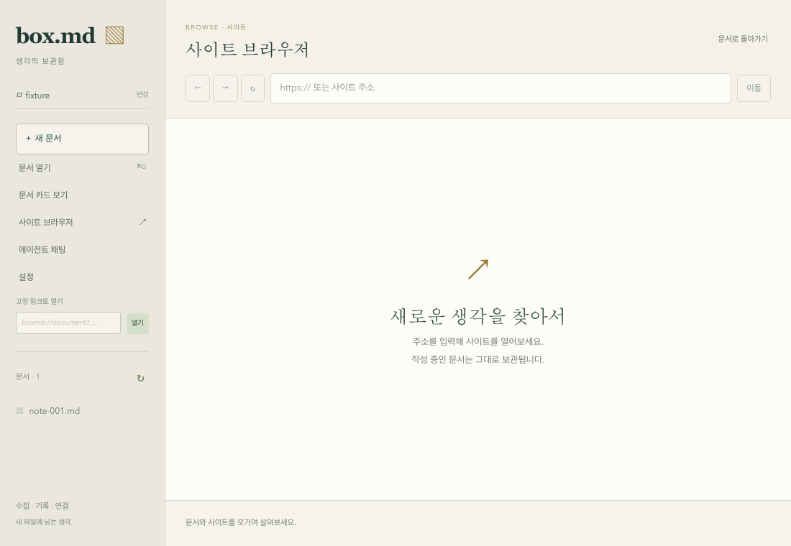

# 앱 내 사이트 브라우징 (gh-4)

문서 편집과 독립된 native WebView에서 사이트를 탐색한다. 주소·탐색 도구와 상태 표시는 로컬 앱 화면이 제공하고 외부 페이지는 별도 `site-browser` WebView가 렌더링한다. 문서 초안과 ACP 세션은 기존 main 화면의 수명주기를 유지한다. 브라우저를 접거나 문서로 돌아갈 때는 외부 WebView를 숨기고 다시 열 때 기존 페이지·엔진 이력을 이어간다.

## 작업과 완료 조건

| 작업 | 범위 | 의존성 |
| --- | --- | --- |
| gh-40 | native WebView·주소/영역 검증·탐색 계약·앱 명령 격리 | 없음 |
| gh-41 | 주소·현재 제목·뒤로/앞으로/새로고침 UI, 표시 영역/숨김 동기화 | gh-40 |
| gh-42 | 실제 macOS WebView의 탐색·렌더링·수명주기·격리 통합 검증 | gh-41 |
| gh-43 | 실제 앱 감사용 loopback HTTP 페이지·임시 문서·실행/정리 검증 | gh-41 |

gh-4는 세 작업 모두에 의존한다. gh-5의 요소 스크랩과 원문 보관은 이 브라우저를 활용하는 별도 기능이며 gh-4 완료를 전제로 진행한다. 브라우저 native 기반의 코드·단위 검증만으로 사이트 브라우징 전체를 완료 처리하지 않는다.

## 구현 경계

`domain/site_browser.rs`는 HTTP(S) 주소 정규화, 표시 영역, 탐색 액션, snapshot을 정의한다. bare hostname은 HTTPS로 정규화하며 자격증명이 포함된 주소·로컬 파일/앱 프로토콜·비정상 입력은 native 페이지를 만들기 전에 거부한다. 화면 영역은 유한한 양수 크기이고 CSS viewport 안에 있어야 한다.

`SiteBrowserHost` port는 페이지/엔진 이력의 소유와 탐색·배치·숨김·상태 조회를 감춘다. `SiteBrowserService`는 입력 검증을 마친 값만 host에 전달한다. native adapter는 같은 main 창의 child WebView를 한 번 생성해 재사용한다. CSS viewport와 실제 창의 논리 크기를 비례시켜 Retina 배율과 페이지 zoom에서도 위치/크기를 계산한다.

설치된 Tauri 2.12.3의 [child WebView API](https://v2.tauri.app/reference/javascript/api/namespacewebview/)는 `unstable` Cargo feature를 요구한다. [WebviewBuilder](https://docs.rs/tauri/latest/tauri/webview/struct.WebviewBuilder.html)의 navigation, page-load, title, new-window hook을 이용한다. 링크와 redirect의 HTTP(S) 탐색을 허용하고 `target=_blank`는 기존 사이트 WebView에서 연다. 로드 완료는 해당 URL의 현재 탐색에만 적용한다. native navigation은 요청을 보낸 직후 반환하므로 open 응답을 페이지 렌더링 완료로 해석하지 않는다.

macOS 뒤로·앞으로 이동과 가능 여부는 Tauri `with_webview`의 UI-thread callback 안에서 실제 WKWebView의 엔진 이력을 사용한다. 타 플랫폼의 뒤로·앞으로는 고정 `window.history` 호출을 사용하고 가능 여부는 `null`이다. 현재 검증 환경은 macOS이며 타 플랫폼 실행 근거는 없다. 새로고침은 Tauri의 native `reload`를 사용한다. native callback 응답 지연 시 호출은 오류로 반환하며 이력이 바뀌었는지 불확실한 액션을 자동 재시도하지 않는다.

child WebView가 추가되면 main은 단일 `WebviewWindow`가 아니다. 단일 인스턴스 활성화·메뉴 종료·ExitRequested 보호는 `get_window("main")`을 사용하고 ACP bootstrap은 실제 `Webview`의 main label/로컬 origin을 확인한다. 기존 문서/ACP 상태를 브라우저의 페이지 수명주기에 포함시키지 않는다.

## IPC와 접근 범위

| 명령 | 입력 | 동작 |
| --- | --- | --- |
| `site_browser_open` | `url`, `bounds` | 주소 검증 후 숨긴 상태로 생성/재사용·탐색 준비 |
| `site_browser_layout` | `bounds` 또는 `null` | 영역 조정/재표시 또는 숨김, 페이지 재탐색 없음 |
| `site_browser_action` | `back`, `forward`, `reload` | 기존 엔진 탐색 |
| `site_browser_snapshot` | 없음 | URL·제목·로드·표시 상태 및 이력 가능 여부 |

공용 TypeScript 계약은 `SiteBrowserBounds`, `SiteBrowserAction`, `SiteBrowserSnapshot`이다. 브라우저 명령은 실제 main WebView와 로컬 앱 origin을 실행 전후 확인하고 blocking worker에서 native 처리를 한다.

Tauri의 [capability 규칙](https://v2.tauri.app/security/capabilities/)은 명령 등록만으로 앱 명령을 각 화면에 제한하지 않는다. 따라서 모든 앱 명령을 `AppManifest::commands`에 등록하고 capability를 창 이름 대신 **main WebView label**에 지정한다. remote capability를 부여하지 않는다. 외부 child가 같은 main 창에 속하거나 앱 주소로 이동해도 파일/연결/Workbench 명령 권한을 얻지 않는다. 자동 생성 permission 파일은 빌드 산출물로 제외하고 원본 명령 목록과 capability를 버전 관리한다.

## 검증 범위

gh-40에서는 주소/영역 검증, 잘못된 입력의 native 호출 차단, 과거 URL의 늦은 완료 차단을 검증한다. 실제 컴파일된 앱 capability와 Tauri MockRuntime의 IPC를 사용해 main의 로컬 앱 명령 허용, remote origin 거부, child의 remote/로컬 origin 모두 거부를 확인한다. 다중 WebView 창에서도 main `Window` 조회·활성화·종료 요청 이벤트가 동작해야 한다.

이 검증은 실제 외부 페이지의 macOS 렌더링/탐색·문서 초안·ACP 세션·종료 보호 화면 증거가 아니다. 해당 기준은 gh-42에 남는다. gh-41은 native 표시 영역을 주소 도구 아래로 제한하고, 창 크기·문서/브라우저 전환·모달·채팅 표시와 동기화한다. 오래 걸리는 로드와 실패한 조작에는 재시도 안내를 제공한다. native 기반만 추가한 gh-40 단계에서는 사용자 화면에 브라우징 UI가 아직 없다.

gh-40의 native 단위 검증은 28개 통과, 명시적으로 실행되는 저장소 peer helper 1개 일반 제외다. 그중 새 검증 6개는 주소 정규화/거부, 잘못된 표시 영역, 과거 URL 완료, native 호출 전 검증, 컴파일된 capability의 실제 IPC 허용/거부와 다중 WebView의 main 창 접근을 확인했다. 같은 실행의 저장소 부모 검증에서 peer 프로세스 3개도 각각 통과했다. 타입·프런트엔드 빌드·Rust fmt·전체 target check가 통과했고 기존 실제 HTTP ACP 통합 1개도 통과했다(설치 에이전트 검증 3개는 이 실행에서 제외). HTTP 통합 결과를 child WebView 표시 중의 실제 native ACP 증거로 확대하지 않는다.

검증 로그는 `/tmp/box-md-gh40-{native,native-check,types,build,fmt,rust,integration}.log`에 있다. 실제 앱 감사는 gh-42에 남고 상위 gh-4도 진행 중이다.

## 주소·탐색 화면 (gh-41)

사이드바의 사이트 브라우저에서 주소 입력, 현재 제목, 뒤로·앞으로·새로고침, 로드 상태를 제공한다. 문서의 HTTP(S) 링크도 이 영역에서 연다. 문서 편집기와 채팅 모델은 마운트를 유지하므로 초안·편집 undo·세션/채팅 초안이 브라우저 전환 중에도 유지된다. 브라우저를 다시 표시할 때 기존 페이지를 배치하며 같은 주소를 다시 탐색하지 않는다. 일반 웹 미리보기에서는 데스크톱 앱 안내를 표시한다.

`SiteBrowserController`는 native 요청을 직렬 처리하며 최신 배치/숨김을 탐색·상태 조회보다 먼저 반영한다. 늦은 열기가 문서나 모달을 덮지 않도록 native open은 창 밖에서 올바른 크기로 생성한 뒤 숨긴 상태로 준비한다. 현재 표시 영역을 확인한 별도 layout 요청만 페이지를 보여준다. 영역은 viewport 안으로 제한하고 채팅 패널의 실제 위치 앞에서 잘라 나란히 표시한다. 작은 창에서 표시 공간이 부족하면 native 페이지를 숨기고 채팅을 닫거나 창을 넓힐 때 복원한다.

설정·미저장·덮어쓰기 모달과 복귀한 문서 화면은 native 숨김 응답을 확인한 뒤 표시한다. 숨김 실패에서는 화면을 먼저 표시하지 않고 다시 시도할 수 있다. renderer 초기화도 기존 child의 숨김부터 확인한다. 지연된 열기·이전 크기 변경 실패·unmount는 최신 숨김 의도로 정리하며 불확실한 뒤로/앞으로 동작을 자동 재실행하지 않는다. 상태 다시 확인은 배치와 조회만 재시도한다. 새로운 브라우저 명령이 없는 이전 개발 백엔드는 기능 미지원으로 안내하고 문서 모달은 계속 사용할 수 있다.

현재 주소/제목 조회는 입력 중인 주소를 덮어쓰지 않으며 제목은 텍스트로만 표시한다. native navigation policy는 서브프레임 URL도 받을 수 있어 주소 표시를 변경하지 않는다. 주 문서의 page-load 이벤트와 로드 완료 후 실제 WebView URL을 사용하고, macOS의 실제 `isLoading`을 함께 조회한다. iframe URL을 현재 사이트 주소로 바꾸거나 commit 이전의 느린 로드를 완료로 보지 않도록 한다. 해당 동작의 실제 native iframe/느린 응답 화면 근거도 gh-42에서 확인한다.

| gh-41 범위 | 검증 근거 |
| --- | --- |
| 주소 정규화·뒤로/앞으로·새로고침 | Chromium의 실제 UI 조작 + native IPC adapter 호출/엔진 이력 모델 |
| 문서 초안·편집 이력 유지 | 문서 링크에서 탐색 후 원래 본문/undo 확인, 문서 쓰기 없음 |
| 재표시·늦은 완료·cleanup | controller 검증과 실제 React 전환, 같은 페이지를 새로 열지 않음 |
| 영역/창 크기·채팅 겹침 | 실제 DOM 영역과 adapter 배치값 비교, 600×480 부족 영역 숨김/복원 |
| 모달 보호·오류 복구 | 지연된 hide 전에 모달 없음, 실패 시 재시도 후에만 표시 |
| 느린 응답·입력/제목 안전성 | 로드 지속 시 안내/명시적 재시도, edited URL 보존·HTML 제목 요소/실행 없음 |
| ACP 유지 | 실제 HTTP/WS ACP 2턴 이후 브라우저 전환 중 프로세스·메시지·채팅 초안·문서 초안 유지 |

브라우징 Chromium 검증 8개, controller/영역 검증 11개가 추가됐다. 전체 Chromium 검증은 45개가 통과했고 사이드바 569개 문서의 760/600/480 높이 스크롤 기준도 유지했다. native 단위 검증 28개 및 실제 HTTP ACP 통합 1개가 통과했다(설치 에이전트 3개는 이 실행에서 제외). HTTP 통합과 Chromium의 사이트 IPC/문서 경계는 adapter를 사용하며 실제 macOS child 렌더링 증거를 대신하지 않는다. gh-42와 상위 gh-4는 미완료다.

최신 주소 요청은 이전의 지연된 준비를 대체하며 이전 페이지를 먼저 표시하지 않는다. 영역 부족만으로 대기 중인 주소를 버리지 않고 표시 공간이 생기면 탐색한다. controller는 표시/숨김과 명시적 닫기·모달 차단을 구분한다.

gh-41의 최종 기본 검사(타입·빌드·Rust fmt·전체 target check)와 desktop 단위 50개, 공용 43개, SDK 75개, facade 16개도 통과했다. 로그는 `/tmp/box-md-gh41-{types,build,fmt,rust,native,tests,controller,browser,layout-browser,integration}.log`에 있다. 실제 native 페이지 렌더링과 UI 상호작용은 gh-42에서 확인한다.
