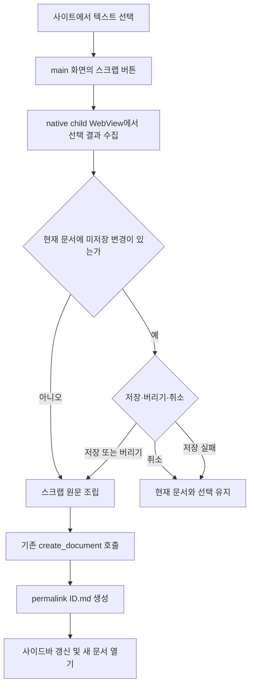

# 사이트 선택 영역 스크랩 구현 계획 (gh-5, gh-91)

## 사용자 흐름

사이트 브라우저에서 페이지의 텍스트를 선택하고 `선택 영역 스크랩`을 누르면 현재 top frame의 URL, 제목, 선택한 일반 텍스트를 한 번에 수집한다. 앱은 현재 문서가 수정된 상태인지 먼저 확인한다. 수정되지 않았다면 바로 새 문서를 만들고, 수정됐다면 기존 저장·버리기·취소 대화상자를 거친다. 취소하거나 저장에 실패하면 파일을 만들지 않는다.



선택은 브라우저가 보이는 동안 먼저 수집한다. 이후 대화상자를 표시할 때 native child WebView를 숨겨도 선택 내용이 사라지지 않는다. 대화상자의 세 선택지는 다른 문서 이동과 설정 변경에 사용하는 기존 동작을 그대로 따른다.

## 선택 결과 계약

native 경계가 반환하는 `SiteSelection`은 아래 세 필드만 가진다.

| 필드 | 의미 | 검증 |
| --- | --- | --- |
| `url` | 수집 순간 top frame의 최종 URL | HTTP/HTTPS, host 필수, credential 금지, 최대 8,192 byte |
| `title` | 수집 순간 `document.title` | 줄바꿈을 공백으로 바꾸고 앞뒤 공백 제거, 최대 512자 |
| `text` | `window.getSelection().toString()` 결과 | 공백만 있는 값 거부, 최대 262,144 UTF-8 byte |

JavaScript의 길이 검사는 큰 값을 IPC로 보내지 않기 위한 1차 제한이다. Rust domain은 역직렬화 후 URL과 UTF-8 byte 길이를 다시 검증한다. iframe 내부 선택은 다른 origin 접근이나 하위 frame 탐색을 시도하지 않으며 top frame selection만 지원한다.

브라우저 없음은 `browser`, 선택 없음은 `selectionEmpty`, 크기 초과는 `selectionTooLarge`, JavaScript 실행 실패는 `selectionScript`, 5초 내 callback이 오지 않으면 `selectionTimeout`, 비지원 플랫폼은 `unsupported`로 구분한다. 사용자 메시지에는 페이지 원문이나 내부 오류 객체를 포함하지 않는다.

## 신뢰 경계

`site_browser_selection` Tauri command는 `main` WebView와 앱의 trusted origin에서만 호출할 수 있다. capability도 `main`에만 부여한다. remote child WebView에는 invoke bridge나 새 권한을 주지 않으며, external/local origin을 가장한 child 호출도 기존 compiled capability 검사와 command의 이중 검사에서 거부한다.

페이지에서 실행하는 스크립트는 값을 읽기만 한다. DOM을 변경하거나 이벤트를 주입하거나 page 객체를 앱으로 전달하지 않는다. 반환된 URL·제목·텍스트는 신뢰하지 않는 입력으로 취급한다. URL은 Rust에서 다시 파싱하고, 제목과 본문은 HTML로 삽입하지 않는다.

macOS adapter는 Tauri가 소유한 현재 `WKWebView` pointer에서 `evaluateJavaScript:completionHandler:`를 호출한다. callback 결과를 JSON 문자열로 받아 Rust DTO로 변환한다. host의 기존 직렬화 mutex 안에서 수집하며, callback이 반환한 URL을 결과 자체의 기준으로 사용하므로 navigation과 경쟁해 이전 snapshot의 제목이나 주소를 섞지 않는다. callback channel과 block은 성공·오류·timeout 뒤 해제한다.

## 생성 문서 형식

프런트의 순수 formatter가 아래 필드를 조립한다. YAML 문자열은 JSON 호환 double-quoted scalar로 기록한다.

- `title`: 정리한 페이지 제목. 비어 있으면 `웹 스크랩`.
- `summary`: 선택 텍스트의 연속 공백을 한 칸으로 줄인 첫 160자 한 줄.
- `source`: 수집 순간 URL.
- `source_title`: 원래 페이지 제목. 비어 있어도 빈 문자열로 기록.
- `captured_at`: 클릭 시각의 ISO 8601 UTC 문자열.
- `permalink`: formatter가 만들지 않는다. 기존 `create_document`가 생성 ID를 넣는다.

선택 텍스트는 Markdown이나 HTML로 해석되지 않도록 `text` fenced code block 안에 둔다. 본문에 포함된 가장 긴 backtick 연속 길이보다 하나 긴 fence를 사용하며 최소 길이는 3이다. 선택 문자열 자체를 수정하지 않고 fence와 구분하기 위한 줄바꿈만 바깥에 둔다.

````text
---
title: "페이지 제목"
summary: "선택 내용의 한 줄 요약"
source: "https://example.com/article"
source_title: "페이지 제목"
captured_at: "2026-10-14T14:00:00.000Z"
---
# 페이지 제목

```text
선택한 원문
```
````

위 예시의 내부 fence는 실제 formatter가 선택 내용에 맞춰 더 길게 만든다. 생성은 작업 디렉터리에 bind된 기존 `create_document(generation, requestId, content)`만 사용한다. 그 서비스가 `YYMMDDhhmmss-randomhex.md` 파일명과 같은 permalink를 원자적으로 발급한다. 경로나 파일명을 페이지 또는 사용자가 지정하는 경로는 추가하지 않는다.

같은 root, 현재 문서 snapshot, 스크랩 content의 전송 결과를 잃은 경우 기존 creation attempt의 request ID를 재사용한다. backend가 구조화된 terminal 오류를 반환하면 다음 사용자 시도에 새 request ID를 발급한다. 성공한 뒤에만 현재 문서를 생성 결과로 바꾸고 sidebar를 새로 조회한다.

## 구현 작업과 의존성

| 순서 | 작업 | 결과 |
| --- | --- | --- |
| 1 | gh-91 | 본 문서로 UX·계약·저장 형식·보안·검증 범위 확정 |
| 2 | gh-92 | Rust domain/port/service/command, macOS WKWebView adapter, main-only capability 구현 |
| 3 | gh-93 | 계약 타입/entity API, formatter, toolbar, workspace dirty 보호와 ID 문서 생성 구현 |
| 4 | gh-94 | 실제 macOS child WebView 및 현재 source 전체 통합 감사 |

각 작업은 앞 작업에 의존하고 모두 gh-5의 완료를 차단한다. 작업별 구현과 필요한 검증을 마칠 때마다 별도 커밋을 만들고 push한다.

## 검증 기준

| 범위 | 반드시 증명할 내용 |
| --- | --- |
| Rust domain/service | 허용 URL, Unicode byte 한계, 제목 정리, 빈 선택, host 오류 전달, host 미호출 입력 거부 |
| macOS adapter | 실제 selection callback, JSON/JavaScript 오류, timeout, page 없음, navigation 중 결과의 URL·제목·본문 일관성 |
| capability/command | main trusted 호출 허용, remote child의 external·Tauri local·dev local origin 호출 거부 |
| formatter | YAML 특수문자, Unicode, 여러 줄, HTML/Markdown 형태, backtick run, summary 160자, ISO 시각 |
| workspace/UI | dirty 저장·버리기·취소, 취소/저장 실패의 무생성, 응답 유실 request ID 재사용, 성공 후 sidebar와 열린 문서, 읽기 모드 해제 |
| browser fixture | 버튼 상태, 선택 없음/성공/오류, 생성 payload와 ID 파일명, 기존 문서·ACP·브라우저 상태 회귀 |
| 실제 앱 | 로컬 HTTP fixture의 실제 DOM 선택부터 디스크 파일까지 end-to-end, child IPC 거부, 큰 선택과 navigation 경쟁 |
| 전체 회귀 | pnpm typecheck/test/build, Rust fmt/check/test, 기존 사이트·문서 생성·ACP browser 검증 |

자동 fixture는 상태 경쟁과 formatter 회귀를 빠르게 확인하는 근거로 사용한다. gh-94 완료 판정에는 현재 source로 빌드한 실제 macOS child WebView에서 선택하고 실제 작업 디렉터리의 파일을 확인한 별도 근거가 필요하다.

## native 선택 수집 구현 결과 (gh-92)

`SiteSelection::new`가 HTTP/HTTPS URL, credential 금지, 512자 제목, 비어 있지 않은 256 KiB 이하 UTF-8 원문을 다시 검증한다. 제목의 CR/LF는 공백으로 바꾸지만 선택 원문의 공백과 줄바꿈은 변경하지 않는다. service와 host port에 `selection`을 추가했고, Tauri의 `site_browser_selection` command는 다른 사이트 명령과 같은 trusted main WebView 검사를 전후에 적용한다. capability에는 main WebView만 유지한 채 새 command 권한만 추가했다.

macOS adapter는 현재 child `WKWebView`에서 하나의 JavaScript 표현식으로 URL·제목·선택 텍스트를 함께 읽는다. `TextEncoder`로 큰 선택을 IPC 전달 전에 거부하고, callback의 JSON 문자열을 Rust DTO로 해석한 뒤 domain 검증을 적용한다. JavaScript 오류와 잘못된 결과, 선택 없음, 큰 선택, 긴 제목, 5초 timeout을 구분한다. 다른 플랫폼은 `unsupported`를 반환한다.

Rust 검증은 domain 6개, site service 1개, command 신뢰·capability 2개, native parsing·timeout 2개를 개별 실행했고 모두 통과했다. 이어서 `cargo fmt --all -- --check`, production `cargo check -p box-desktop`, 전체 native library 103개 통과와 1개 worker fixture ignore를 확인했다. 실제 DOM selection callback과 remote child의 실제 invoke 거부는 현재 source로 빌드하는 gh-94 감사에서 다시 확인한다.

## 문서 생성 UI 구현 결과 (gh-93)

공용 계약에 `SiteSelection`을 추가하고 entity API가 native 결과의 URL·제목·본문 shape를 확인한다. 순수 formatter는 JSON 호환 YAML scalar로 `title`, `summary`, `source`, `source_title`, `captured_at`을 만들며 permalink는 넣지 않는다. 선택 원문 안의 가장 긴 backtick run보다 긴 `text` fence를 사용하고 제목의 Markdown/HTML 구분 문자를 escape한다. 한줄 summary는 공백을 합친 뒤 Unicode code point 160개로 제한한다.

사이트 toolbar는 페이지가 열려 있고 loading·layout·문서 작업이 없을 때 `선택 영역 스크랩`을 제공한다. 캡처 진행 중에는 버튼을 잠그고 selection 오류와 문서 생성 오류를 현재 사이트 footer에 표시한다. 같은 URL·제목·본문을 다시 캡처하면 최초 `captured_at`을 유지하므로 workspace creation attempt가 같은 content와 request ID로 재시도한다. 성공 callback에서만 retry cache를 비우고 사이트 화면을 닫는다.

workspace action은 선택을 먼저 받은 뒤 기존 dirty 대화상자에 저장·버리기·취소를 적용한다. 취소와 저장 실패는 생성 service를 호출하지 않는다. 생성은 기존 generation과 `create_document`만 사용하며 성공하면 읽기 모드를 해제하고 생성 결과를 열어 sidebar를 갱신한다. 다른 이름으로 저장 경로나 페이지 제공 파일명은 없다.

formatter 3개, HomePage 44개가 통과했다. Playwright에서는 새 스크랩 3개를 포함한 사이트·문서 생성·설정 23개가 통과했다. 성공 검증은 unsafe 제목/HTML 형태와 Unicode·여러 줄·긴 backtick을 ID 파일과 metadata/fence에서 확인했고, dirty 취소 후 무생성·버리기와 원본 유지, 응답 유실 후 동일 request ID와 파일 한 개를 확인했다. 최초 전체 55개 실행에서 숨겨진 사이트 footer가 기존 오류 locator를 중복시키는 회귀를 발견해 열린 사이트에서만 workspace 오류를 전달하도록 고쳤고 관련 23개를 다시 통과시켰다.

## 상위 feature 최종 수용 기준 (gh-5)

2026-10-15 현재 source의 [실제 앱 감사](site-selection-scrap-native-audit.md)를 기준으로 URL 내 선택 영역을 원문 Markdown 문서로 저장하는 흐름을 완료했다. 설계 gh-91, native 수집 gh-92, UI·미저장 보호 gh-93, 실제 앱 통합 gh-94 및 감사 중 발견한 focus 전환 버그 gh-96의 구현·검증 근거를 연결한다.

| 요구사항 | 완료 근거 |
| --- | --- |
| 사이트 선택 영역 수집 | 실제 macOS child WKWebView의 여러 줄·Unicode·Markdown/HTML 형태·긴 backtick 선택부터 native callback까지 확인. gh-96에서 toolbar focus 전환과 반복 선택 손실 해결. |
| 원문과 출처 저장 | 실제 ID.md 5개의 permalink·title·summary·source·source_title·captured_at과 동적 fence 내부 원문을 디스크에서 파싱·대조. 원문은 실행되지 않는 text fence로 보존. |
| 문서 작업 흐름 | sidebar 갱신·새 문서 편집 모드 열기·실제 원문 편집/Cmd+S, dirty 취소·버리기·저장, 생성 실패의 무생성과 권한 복구 후 재시도 확인. 응답 유실 request ID 재사용은 기존 실제 파일 backend와 browser 회귀로 검증. |
| 경계·기존 상태 보존 | 선택 해제·빈 선택·256 KiB 초과·navigation의 안전한 처리와 URL/제목 snapshot, 실제 remote child 7명령 denied. 실제 ACP session·응답·draft 유지 및 원본 hash/본문 보존 확인. |
| 전체 검증 | 현재 source typecheck/test/build, desktop Vitest126·Playwright56, fixture Node4·Chromium9, Rust fmt/all-target check/workspace test 1018 passed/9 ignored. |

실제 앱 감사는 격리된 QA94 프로필과 소유 임시 문서만 사용했고, QA session·앱·fixture를 종료·정리했다. 외부에서 수정 중인 ACP UI 두 파일은 커밋에 포함하지 않았다. 모든 구현·검증 작업을 개별 커밋으로 push했다.
