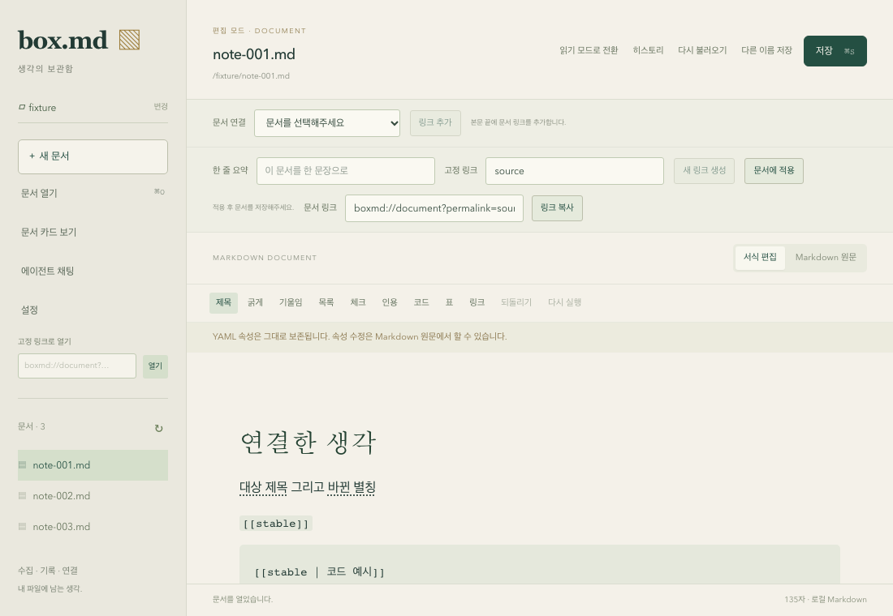

# permalink 위키 링크 (gh-18)

본문에 `[[permalink]]`를 작성하면 대상 문서의 최신 제목을 표시한다. `[[permalink | alias]]`는 별칭을 표시한다. 구분자 주변 공백을 허용하며 저장할 원문에는 입력한 permalink·별칭·공백을 유지한다. 제목이나 파일 경로가 바뀌어도 대상의 frontmatter permalink가 유지되면 연결을 유지한다.

제목은 대상 frontmatter의 `title`, 본문의 첫 실제 Markdown 제목, 파일명 순서로 정한다. 문서 열기·저장·문서 목록 새로고침에서 최신 정보를 조회한다. 읽기·서식 모드에서 링크를 누르면 현재 작업 디렉터리의 대상을 확인해 연다. 미저장 문서가 있으면 기존 저장·버리기·취소 동작을 사용한다.

없는 대상은 `문서 없음`, 중복된 permalink는 `중복`, 읽기 실패나 부분 목록 등 유일성을 확인할 수 없는 경우는 `확인 오류`를 표시한다. 이런 링크에는 이동 가능한 href를 제공하지 않는다. 문서 목록을 새로고침하면 상태를 다시 확인한다. 작업 디렉터리가 없으면 선택 안내를 표시한다.

코드 블록과 inline code의 `[[...]]`는 코드 텍스트로 유지한다. 위키 링크는 gh-19의 독립 연결 엔티티와 별개이며 본문 작성·삭제는 명시적 연결 관계를 생성·삭제하지 않는다. 링크 표시와 조회는 문서를 쓰지 않는다. 본문 저장은 기존 문서 저장 경로를 사용한다.

## 구현 및 검증 범위

공용 `packages/editor`는 inline leaf atom에 permalink·alias·raw를 보관한다. 제목·상태 갱신은 NodeView에만 적용하므로 본문 transaction이나 undo 항목을 만들지 않는다. 출력 label은 `textContent`로 넣고, HTML clipboard는 검증된 raw로 복원한다. 앱의 workspace 인덱스는 기존 고정 링크 이동과 판정 규칙을 공유한다. 비동기 조회가 끝나기 전에 작업 디렉터리가 바뀌면 이전 결과를 표시하지 않는다.

아래 Chromium 검증은 실제 React 앱, Tiptap 파서/serializer 및 NodeView를 사용한다. 문서 목록·내용·저장 IPC만 native test adapter로 대체하고 그 adapter의 문서 목록/내용을 바꾸어 외부 제목 변경과 파일 이동을 재현한다. 저장 버튼의 payload를 확인한 뒤 다른 문서를 열었다가 재열어 확인한다. macOS 실제 창이나 실제 파일 이름 변경을 이 검증으로 확인했다고 주장하지 않는다. 별도의 native 문서 저장·재열기·충돌·히스토리 테스트 15개는 gh-16 감사에서 통과했다.

| gh-18 수용 기준 | 확인 근거 |
| --- | --- |
| 1. 제목을 표시하는 기본 링크 | `wikilink-display.spec.ts`의 실제 서식 모드 제목 표시·클릭, `wikilink-preservation.spec.ts`의 읽기 모드 제목 표시를 확인한다. |
| 2. 별칭과 구분자 공백 | 두 브라우저 파일에서 공백 있는 원문 표기와 고정 별칭을 확인한다. 공용 13개 parser/clipboard 검증에 Unicode·추가 구분자·원문 공백 보존이 포함된다. |
| 3. 이동과 미저장 보호 | 기본 링크 클릭의 취소·버리기·저장 후 이동 3개를 확인한다. 별칭 링크의 다른 대상 이동, 이름이 바뀐 대상 이동도 확인한다. |
| 4. 최신 제목·경로 변경 | native adapter의 대상 제목/경로를 바꾼 후 목록을 새로고침한다. 기본 링크는 최신 제목, 별칭 링크는 기존 별칭을 표시하며 미저장 초안을 유지하고 변경된 경로를 연다. 문서 해석 테스트는 title 우선순위·실제 heading·파일명·경로 변경을 확인한다. |
| 5. 원문 작성·수정·보존 | 읽기/서식/원문 전환, 원문에서 대상 ID·별칭 변경 후 표시, 주변 본문 키 입력, 저장 payload 및 다른 문서 후 재열기 원문을 확인한다. 저장 원문에서 제목으로 permalink가 대체되지 않는다. |
| 6. 누락·중복 구분 | 실제 화면의 `문서 없음`/`중복`과 비활성 href를 확인하고 포인터 클릭을 시도해도 임의의 문서를 열지 않는다. 부분 목록에서 확인 오류로 전환한다. 문서 해석 테스트는 읽기 실패·잘못된 제목 속성도 확인한다. |
| 7. 코드 제외 | 실제 화면에서 inline/fenced code 예시가 링크 수에 포함되지 않으며 저장 후에도 코드로 남는다. 공용 parser는 코드·이스케이프 표기를 링크로 해석하지 않는다. React 조회 hook은 frontmatter 표기도 조회 대상에서 제외한다. |
| 8. 검증과 기본 검사 | 공용 43개, desktop 34개, SDK 75개, chat facade 16개와 Chromium 27개가 통과한다. 프로젝트 기본 검사도 통과했다. |

Chromium 27개 중 7개가 위키 링크 검증이다. HTML 형태의 제목·별칭을 실제 화면에 표시해 실행 가능한 태그·스크립트 실행·외부 요청이 발생하지 않음을 확인했다. 공용 NodeView 검증 3개는 제목/별칭 표시 갱신이 원문·transaction에 영향을 주지 않고 삭제된 편집기의 구독이 정리되는지 확인한다. React 조회 검증은 이전 workspace 결과를 무시하고 주변 본문 편집만으로 재조회하지 않는지 확인한다.

실행한 기본 검사는 `pnpm check-types`, `pnpm test`, `pnpm --filter @box/desktop test:browser`, `pnpm build`, `cargo fmt --all -- --check`, `cargo check --workspace --all-targets`다. 로그는 `/tmp/box-md-gh34-{types,tests,browser,build,fmt,rust}.log`에 있다. 영구 검증 근거는 커밋된 테스트와 이 문서다.

하위 작업은 gh-32(공용 파서), gh-33(제목·상태·이동), gh-34(통합 감사)로 구분한다. 설계와 단계별 구현 내역은 [wikilink 구현 계획](wikilink-implementation-plan.md)에 있다.
