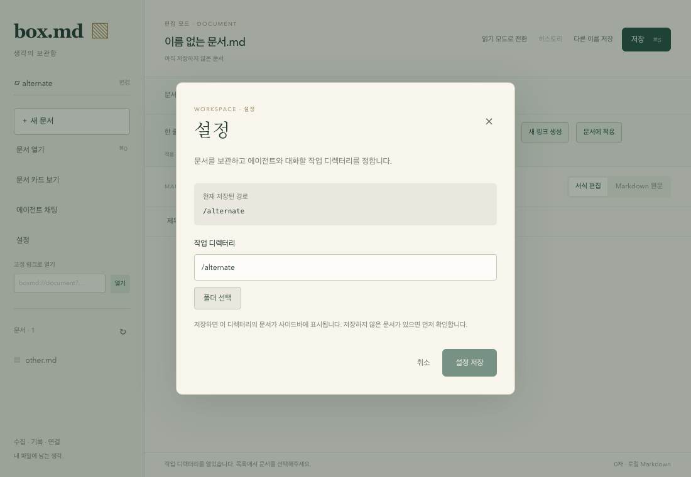
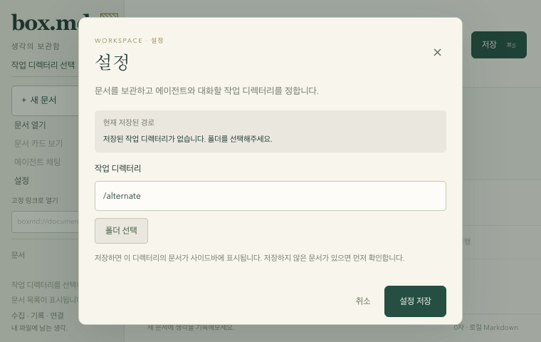

# 작업 디렉터리 설정 (gh-14)

사이드바의 **설정**에서 저장된 작업 디렉터리를 확인하고 **폴더 선택 → 설정 저장**으로 변경한다. 폴더를 선택하는 동안에는 현재 문서와 작업 디렉터리를 변경하지 않는다. 폴더 선택 취소는 선택 중인 경로를 유지하고, 설정 취소·닫기는 저장된 설정을 유지한다.

저장할 때 선택한 폴더의 접근 가능 여부와 Markdown 목록을 확인한 뒤 설정을 저장하고 사이드바에 적용한다. 미저장 문서가 있으면 기존 **저장 후 계속 / 변경 버리고 계속 / 취소** 확인 절차를 거친다. 이 확인에서 취소하면 문서와 작업 디렉터리 모두 유지된다. 저장한 경로는 앱 재실행 시 복원한다.

저장된 폴더가 삭제되거나 접근할 수 없어도 설정에 저장된 경로를 표시한다. 다른 폴더를 선택하거나 같은 경로를 다시 저장해 복구할 수 있다. 폴더 접근 또는 설정 저장 공간 오류가 발생하면 기존 문서·설정을 변경하지 않고 오류를 표시한다. 긴 경로는 설정 화면에서 줄바꿈해 확인한다.

## 구현

- `features/workspace-settings`는 폴더 선택 초안과 설정 dialog를 관리한다. 폴더 선택만으로 파일이나 저장 설정을 변경하지 않는다.
- `features/manage-document`의 workspace 요청이 디렉터리 검증·설정 저장·적용과 미저장 보호를 처리한다. 저장된 설정 경로는 현재 성공적으로 열린 workspace와 별도의 상태로 유지한다.
- 설정은 기존 `box.md.workspace-path` localStorage 키를 사용한다. 저장 실패를 무시하지 않으며 저장이 성공한 뒤에만 현재 workspace와 문서를 전환한다. 이미 같은 canonical 경로가 저장된 경우 불필요한 재저장을 하지 않는다.
- 설정이 열려 있는 동안 문서·사이드바·채팅은 inert 상태다. 설정을 열거나 닫는 동작으로 편집기·채팅을 unmount하지 않는다. Escape 닫기와 Tab 포커스 순환을 지원한다.

## 하위 작업과 검증

- gh-26: 설정 UI와 저장 흐름. desktop 27개 단위/React 흐름 테스트, 기존 실제 HTTP ACP 통합, 사이드바 Chromium 5개 회귀 검증 및 프로젝트 기본 검사 통과.
- gh-27: 실제 Chromium 설정 검증 8개와 사이드바 회귀 5개, 총 13개 통과. 명시적 저장과 reload 복원, 선택/설정 취소, 미저장 save/discard/cancel, 접근 불가 복구, 접근/저장 오류 시 기존 문서·설정 유지, 최초 설정 및 760×480 창 조작을 확인했다. 작은 창에서 제목이 가려지지 않도록 여백을 조정했다.
- gh-28: 실제 Tauri 앱에서 네이티브 폴더 선택·저장, 완전한 프로세스 종료·재실행 후 경로와 목록 복원, 접근 불가 경고와 재선택 복구를 확인했다. 별도 NativeQA 프로필과 임시 문서를 사용하고 원본 해시 및 사용자 앱 유지도 확인했다. [native 실행·기준별 근거](workspace-settings-native-verification.md)를 참고한다. 상위 gh-14의 전체 완료 여부는 별도 감사로 판단한다.





```sh
pnpm check-types
pnpm build
pnpm test
pnpm --filter @box/desktop test:integration
pnpm --filter @box/desktop test:browser
cargo fmt --all -- --check
cargo check --workspace --all-targets
```
